# Getting Started With Umod4

> **Using an AI coding assistant (for example Claude Code in VS Code)?**
> Paste the link to this page into it and tell it to read AGENTS.md first.
> If you are an AI coding agent: before doing anything else, read AGENTS.md in the repository root (https://github.com/mookiedog/umod4/blob/main/AGENTS.md).
> It explains who you are probably working with, what to ask them, and how to help them.

Getting a umod4 installed is a case of "some assembly required", but it is not as difficult as it might first appear.
Read [Before you start](#before-you-start) and check the [parts lists](#parts) first.
The steps below will be covered in detail:

1) [Modify the ECU](#modify-the-ecu)
1) [Check umod4 board construction](#check-umod4-board-construction)
1) [Prepare the GPS](#prepare-the-gps)
1) [Mount the umod4 in the ECU](#mount-the-umod4-in-the-ecu)
1) [Install the Pico2W](#install-the-pico2w)
1) [Set up your PC](#set-up-your-pc)
1) [Install the WP software](#install-the-wp-software)
1) [Provisioning](#provisioning)
1) [Install the EP software](#install-the-ep-software)
1) [Install the ECU on the bike](#install-the-ecu-on-the-bike)
1) [Garage setup](#garage-setup)
1) [Installation complete!](#installation-complete)

Each step ends with a checkpoint: something you can see or test to confirm that the step worked before you go on.

## Before you start

Three decisions come before you buy any parts.
In addition, check [Is it for you?](./WHY_UMOD4.md#is-it-for-you).

**1. Are you willing to modify the ECU?**
A umod4 needs a socket soldered into the ECU's circuit board (see [Modify the ECU](#modify-the-ecu)).
Without that socket, a umod4 cannot work.
The modification does not change how the ECU behaves, and you can always put an EPROM back in.
If you do not want to do the soldering yourself, find someone who does.

**2. Which maps will your bike run?**
The umod4 replaces your EPROM, so something has to supply the ECU's program and its fuel and ignition maps.
You have three options:

* **The built-in maps.**
  The umod4 includes stock 549USA maps.
* **A stock unprotected RP58-compatible Aprilia image.**
  The project does not include any, but `.bin` files for many of them can be found on the web.
* **Your own unprotected image.**
  A 32 KB `.bin` file of your current unprotected EPROM.
  The `.bin` file can come from an EPROM reader or it can be produced by tuning software such as TunerPro.

**Protected EPROMs are a problem.**
Some Aprilia and many aftermarket chips are scrambled so that they only function in conjunction with a daughterboard that plugs into the ECU's EPROM socket.
The umod4 software in this repository cannot descramble those images.
If your chip is protected and you cannot get an unscrambled file, you will need to find a .bin file for an unprotected EPROM with maps that work with your bike.

You do **not** need a `.bin` file to verify umod4 operation.
But before trying to start your bike's engine, if your bike requires anything other than built-in 549USA maps, you must install at least one compatible EPROM image.

Installing images is described in the User Guide: see [Choosing what the ECU runs](./USER_GUIDE.md#choosing-what-the-ecu-runs-eprom-images).
Before you ride on any new image, read the testing advice in the User Guide's [Safety](./USER_GUIDE.md#safety) section.

**3. Garage WiFi.**
The umod4 really needs power and WiFi where the bike is parked.
Power is usually not a problem given that the big Rotax twins seem to need their batteries to be on chargers all the time.
WiFi might be trickier though for some locations: see [Garage WiFi](#garage-wifi) for what you need and some options.

## Parts

Check your parts before you start.
They will be used in subsequent steps.

### Loose parts that ship with umod4

* one 12-pin SIP socket strip (for the CN1 modification, see [Modify the ECU](#modify-the-ecu))
* two 20-pin male-male round-pin strips (for the Pico2W)
* one 5-pin male-male round-pin strip (for the GPS module)
* four each of M3 nylon standoffs (8mm tall, thread length 6mm) and M3 nylon screws (thread length 6mm)

### Parts a user must supply

* A Pico2W module. Do **not** get a module with headers already soldered: they are square pin headers and they will **not** work with the umod4's round pin sockets!
* A USB power supply: 5V at 1A is fine.
* A micro USB data cable for initial software install, plus powering the umod4 when mounted on the bike.
    I use a 1 meter cable.
* A "double sided" uBlox NEO8M module.
    These are available on Ali Express.
    Contact me if you are not sure what to get.
    The Ali Express modules almost all arrive with square-pin headers preinstalled.
    These will need to be removed, then replaced with a 5 pin male-male round pin strip.
* An amplified antenna for the GPS module (also from Ali Express).
* M3 (metric) nylon hardware: screw, nut, and spacer to mount the GPS module to the umod4.
    See [Mount the GPS](#mount-the-gps) for what to look for.
* A micro SD card. It is **not** worth spending money on a large capacity card.
    A 32G to 64G card is fine and will hold hundreds of ride logs.

## Modify the ECU

An ECU *must* be modified to use a umod4.
The modification is simple and backwards-compatible: a modified ECU will function completely normally if you replace the umod4 with an EPROM afterwards.

**If you do not want to modify your ECU, stop here: the umod4 will not work without the modification!**

### Background

All gen 1 ECUs were shipped with an uninstalled connector, marked **CN1** as seen below (top, center):

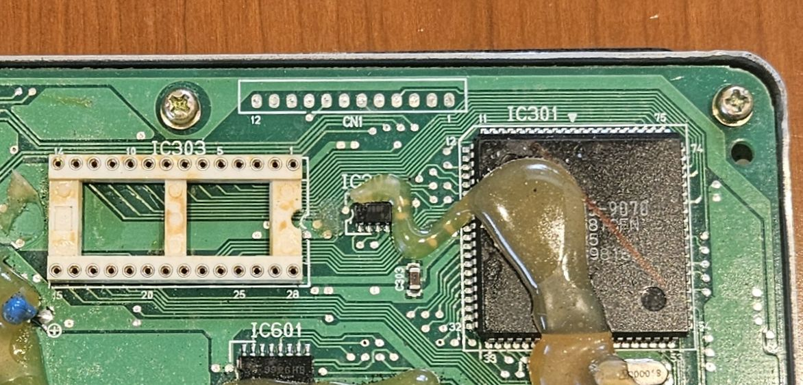

CN1 gives the umod4 access to extra power & ground pins, as well as some important ECU processor signals that are not available at the EPROM socket.

The umod4 needs a socket added to the CN1 mounting holes.
A umod4 board needs to plug into the existing EPROM socket as well as a new CN1 socket.

Adding this socket is easy as PCB rework goes.
But if you are not confident in your skills, **find someone who is**.

**WARNING: be static safe when working with the ECU:**
* **Wearing a ground strap is strongly recommended whenever you handle the ECU or umod4 PCBs!**
* **Use an anti-static bag for the ECU and umod4 PCBs. Keep them in a bag when not in use!**

### Process

Start by removing the ECU from bike.
If you have never done that before, pay attention to the locking tabs when disconnecting the two big wiring harness connectors from the ECU.

With the ECU on a workbench, perform the following steps:

1) **Remove the ECU cover** (4 screws)

1) **Remove ECU circuit board from ECU** (9 screws)

    * 7 screws on the PCB itself
    * 2 screws that hold the PCB's heat sink to the steel fin on the ECU's bottom plate

    **Be static safe! Keep the board in a static bag while you are not working on it.**

1) **Remove Solder From CN1 Solder Pads**

    Use a soldering iron and a cheap [solder sucker](https://www.amazon.com/s?k=solder+sucker) to remove the solder from all 12 holes on connector CN1.

    My technique:

    * Clamp the board vertically
    * **FIRST:** place the sucker directly over a hole on one side of the board
    * **THEN:** melt the solder from the other side, trying not to cover the hole with the iron's tip
    * trigger the sucker while the tip has the solder melted

    If you have trouble getting all the solder out, let the board cool.
    Start over by adding some solder to refill the hole, then try the sucker again.

    The goal is to end up with nice clean, solder-free mounting holes, as seen below:

    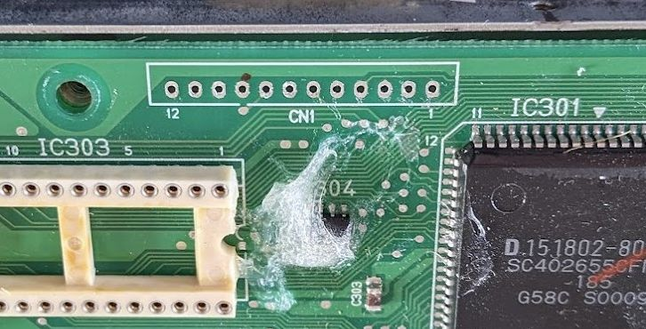

1) **Install Round-Pin SIP Socket Strip into CN1**

    Insert the 12-pin [SIP socket strip](#round-pin-sip-sockets) into the CN1 holes.
    The SIP socket holes need to face **the same direction as the EPROM socket holes**.
    You will be soldering on the back side of the ECU PCB.

    To hold the new strip socket in place while it gets soldered, I use a rubber band around the whole ECU PCB.
    The rubber band only needs to be tight enough to hold the SIP socket vertical and steady while you solder the first pin.

    Applying a bit of electronics soldering flux is strongly recommended before soldering the socket pins!

    Start by soldering just one pin somewhere in the middle of the strip.

    After the first pin is soldered, **STOP:** visually verify that the SIP socket is both perfectly vertical and pressed tightly against the ECU PCB.
    If needed, you can easily make adjustments at this stage by remelting the single soldered pin and adjusting the socket with your finger.

    Once you are happy with the alignment, solder all remaining pins on the SIP socket.

    After soldering: do a visual inspection of your joints using a magnifier like a jeweler's loupe.
    **Bad solder joints can cause all kinds of crazy/intermittent problems, especially in a high-vibration environment like a motorbike.**

    If you have some "flux remover" spray, it is a good time to clean the back of the ECU PCB where you added CN1.
    You can also use a Q-tip cotton swab and some isopropyl alcohol to clean off the flux residue.

    When complete, your ECU should look like this:

    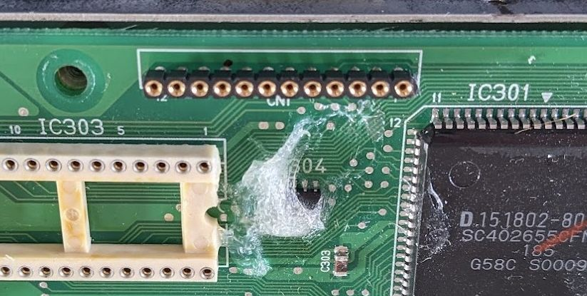

1) Mount ECU PCB

    Once the ECU PCB passes visual inspection, it can be remounted onto the ECU's steel bottom plate.
    When screwing down the ECU PCB, 4 of the original screws will be replaced with M3 nylon 8mm standoffs in the locations shown below.
    These standoffs should **NOT** get torqued too tightly: they are plastic, not steel!
    Finger tight is good enough.

    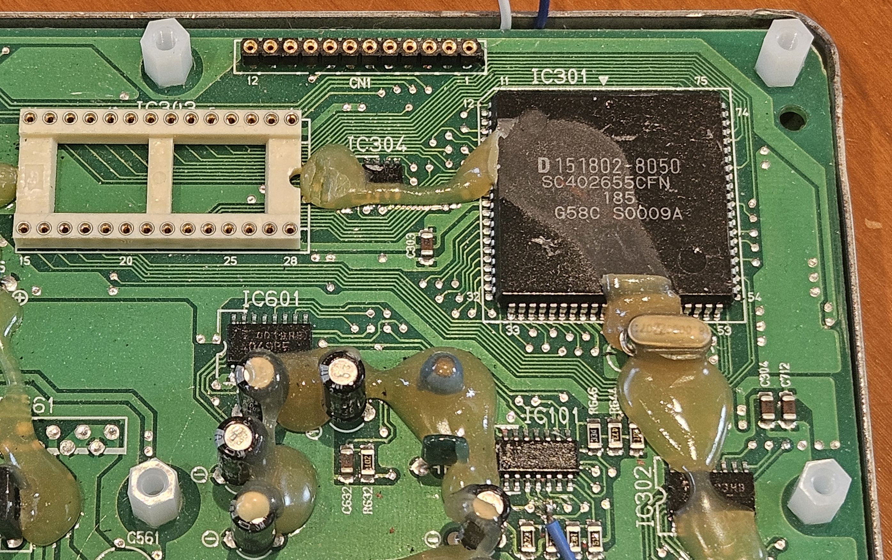

**Checkpoint:**

* the 12-pin socket strip stands vertical and flush against the ECU PCB
* every pin is soldered
* you have inspected each joint
* the ECU PCB is remounted with nylon standoffs in the proper location, finger tight!

## Check umod4 board construction

It is possible that certain parts might not be present on a board you receive.
This section makes sure that everything you need is installed.
If your board is missing any of these parts, you will need to obtain them and solder them on yourself.
See [Appendix A: Building a board from scratch](#appendix-a-building-a-board-from-scratch) and [Appendix B: Parts and sourcing](#appendix-b-parts-and-sourcing) for help in that regard.

### Confirm male-male mounting pins on rear

Confirm that the umod4 board has the 3 round-pin male-male mounting strips installed.
They are the 3 black male-pin strips seen here:

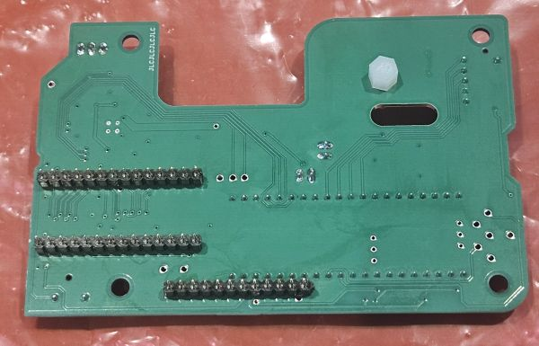

### Confirm SIP sockets on front

Confirm that the board has SIP sockets for the Pico2W and the GPS module.
The GPS socket is the 5-pin SIP socket in the upper left.
The Pico2W socket is made from the two long 20-pin SIP socket strips:

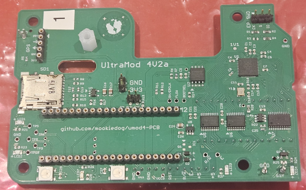

**Checkpoint:**

* Three male-male mounting strips are confirmed present on the rear of the board
* Three female SIP socket strips for Pico2W and GPS are present on the front

## Prepare the GPS

All of the GPS modules I have obtained from Ali Express arrive with 0.025" square pin headers already soldered into them.
Since the umod4 board has a round-pin socket for the GPS, these headers need to be replaced.

The easiest way to remove the square-pin headers is destructively: use flush cutters to cut off the pins as they exit the plastic, then break the plastic between each pin.
This allows the old pins to be unsoldered and removed one at a time.
Use a solder sucker to clean out the old holes.

Carefully examine the male-male pins.
You will see that the two sides are different:

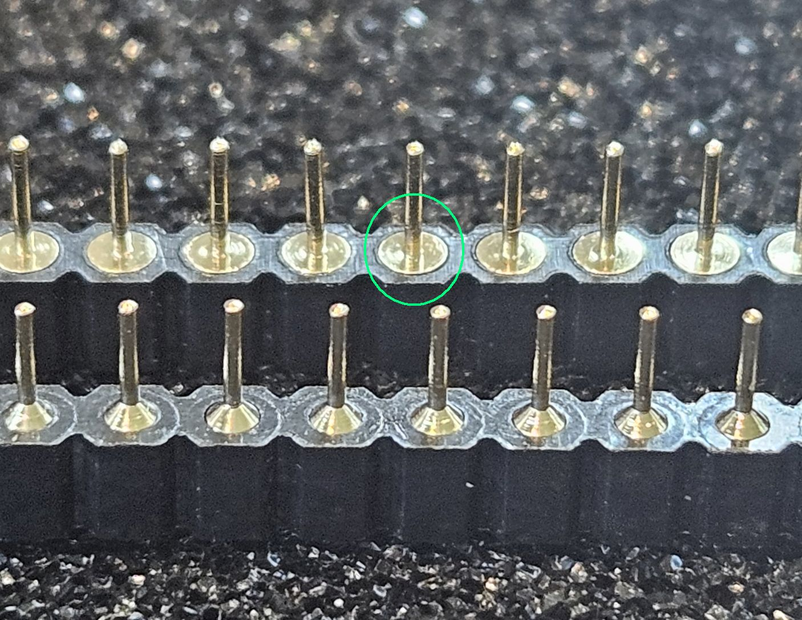

The flat side is designed to sit against the circuit board that the strips are soldered into.
The conical side of the strip is designed to plug into a socket.

Insert the male-male pin strip on the side of the GPS with the uBlox module so that the flat side of the strip is flush with the GPS module's circuit board.
The conical side of the pins should face away from the PCB, as shown below:

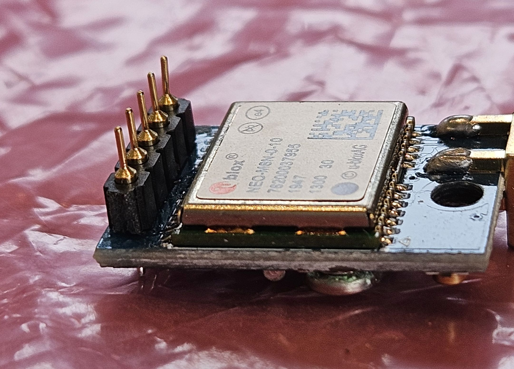

Make absolutely sure that your setup matches the photo:

* the male-male pin strip is on same side as uBlox module
* conical side of strip pins faces **away from the GPS board**

If so, then flip the GPS module over and solder the interconnect strip.

### Mount the GPS

Mounting the GPS involves working with a umod4 board that is loose on a static-safe benchtop, not yet installed in the ECU.

**Be very careful at this stage to avoid accidentally bending the male-male mounting pins on the backside of the umod4!**

Plug the GPS module into the 5-pin GPS socket on the umod4.
It should look like this:

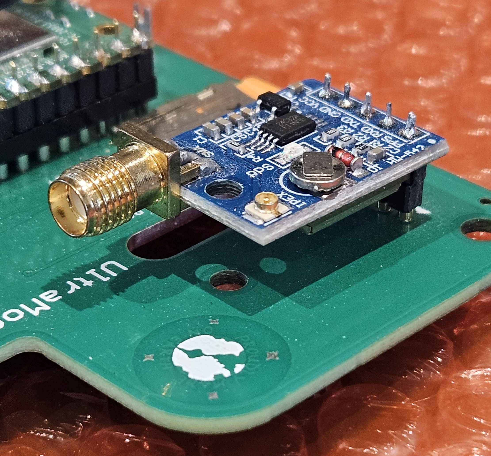

You need to mechanically screw the GPS down at this point while the back of the umod4 board is still accessible.
Once the umod4 is plugged into the ECU, it is very difficult to reach a fastener on the backside.

My apologies: you are on your own at this step and may have to make a trip to the hardware store.
I use a nylon screw, spacer, and nut to mount the GPS to the umod4. A 15-ish mm metric M3 screw will do.
You might need to shorten a 20mm screw.
I made my own nut for the bottom by cutting the threads off a 6mm nylon standoff with an xacto knife.
Whatever you use on the backside should be no taller than 6mm or else it will contact the ECU PCB and the umod4 will not sit flat!
The spacer should be approximately 8mm tall and **made of plastic** to avoid potential electrical shorts on the GPS module pins.
The length of the spacer should be such that the GPS module sits parallel to the umod4.

*Don't bother attaching the GPS antenna yet.
It would not hurt, but it would mainly be in the way during the next sections*

**Checkpoint:**

* GPS has square-pin header removed
* GPS module has its round-pin male-male strip soldered down precisely as per the photo
* GPS module plugged into its socket as per photo
* Mounting screw and spacer installed and screwed down
* Verify GPS mounting hardware on the backside of the umod4 is no more than 6mm thick

## Mount the umod4 in the ECU

With the GPS module installed and screwed down, it is time to install the umod4 in the ECU.

This is not hard, but it is slightly trickier than installing a plain EPROM because now you need to line up three sets of pins.

**Carefully** get all 3 rows of pins lined up with their socket holes on the ECU PCB.
It is easiest to start with the new CN1 pins because they are very easy to see.
Once they are lined up, verify that the pins that mate with the EPROM socket are also properly lined up.
You should notice that the pins will drop into their corresponding socket holes for a few mm before they stop moving.
This is good: it indicates that your alignment is correct.

**If you are at all unsure with the alignment, start over!**

Once you are happy with the pin alignment, put one thumb on top of the chip labeled U6, and your other thumb between the Pico2W socket strips at the end nearest U6.
Press down with both thumbs to seat the board.
It should end up flush with the 4 nylon standoffs that you mounted previously.

Once seated, the umod4 mounting holes should line up precisely with the holes in the standoffs.
Use the four M3 6mm nylon screws to attach the umod4 to the standoffs.
Again, lightly tighten the nylon screws with a screwdriver.
It would not be a disaster to break off a mounting screw because the standoffs are replaceable, but there is no need to overtighten them!

It should all look like this:

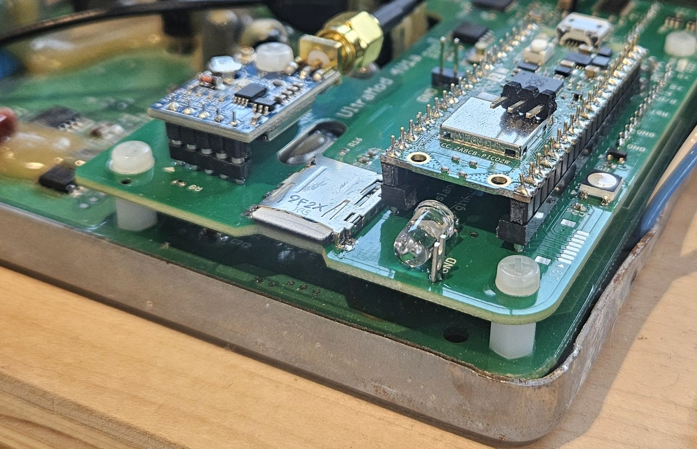

*The ECU lid will remain off, forever.
The umod4 is too tall to fit under it.
At some point in the future, it might be good to get someone to 3D print a new cover.*

**Checkpoint:**

* umod4 sits flush on all four nylon standoffs, holes aligned, screwed down with nylon screws

## Install the Pico2W

Pico2W boards arrive as bare boards with no mounting pins.

**Reminder: Umod4 SIP sockets require 0.020 round pins, not 0.025 square pins! Do NOT use Pico2W modules with pre-installed square pin headers!**

To achieve perfect alignment between the Pico2W and the umod4 socket, the Pico module gets soldered in-place on top of the umod4:

1) Plug a 20-pin male-male strip into each of the two Pico2W sockets on the umod4.
    Verify that the conical side of each strip goes **down** into the socket on the umod4.
    The flat side of the strip faces up.

    

    *Male-male strips flat side (circled in green) versus conical side*

1) Place the Pico2W module onto the two strips.
    The flat side of each strip must sit flush against the underside of the Pico's PCB.
    The USB connector on the Pico2W faces away from the SD card holder:

    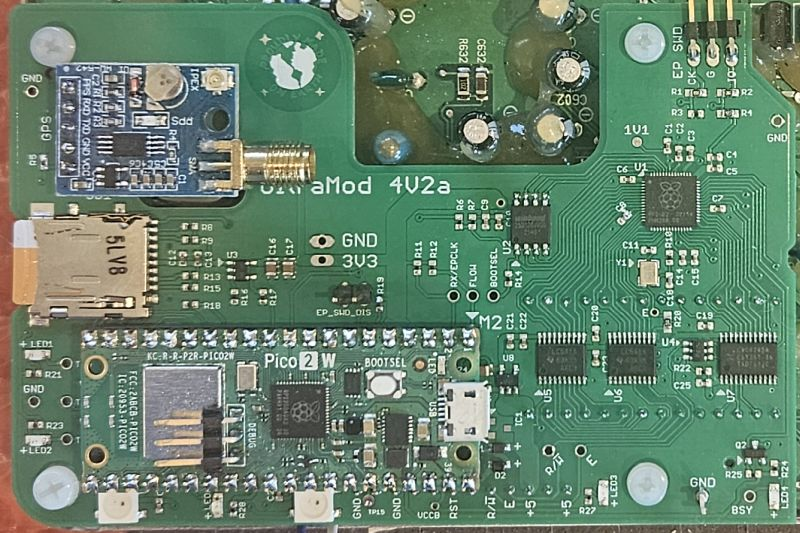

1) Solder one pin in the middle of the Pico pins.
   Check that the Pico is level and both strips are flush, then solder the remaining pins.

1) Do a visual inspection of every joint!

The Pico2W stays plugged into the umod4 from here on.

**Checkpoint:**

* The Pico2W sits flush on both socket strips
* All pins soldered
* Pico2W USB connector faces away from the SD card holder

## Set up your PC

The umod4 server is a program that runs on a PC on your home network.
It is what downloads your ride logs automatically, and lets you update your umod4's firmware over WiFi.

This setup process is a one-time job.
If you have a PC at home that tends to be on all the time, that's a good choice.
You could also install it on a laptop that you would bring to a track day, for example.

This step does not involve the umod4 hardware at all.
You can do it at any time, even before your parts arrive.

**You need a Linux PC, or a Windows 11 PC (22H2 or later).**

Windows 10 is not supported: the umod4 finds the server using UDP broadcasts, and that needs WSL's mirrored networking, which requires Windows 11 22H2 or later.

An AI coding assistant can do most of this setup with you: see the AI assistant row in the [README](README.md#where-to-go).

**On Windows**, first set up WSL (Windows Subsystem for Linux), the Linux environment that runs the server:

* [Install WSL](./BUILDING.md#install-wsl2-and-your-ai-assistant)
* [Set up WSL networking](./BUILDING.md#set-up-wsl-networking) and [add the Windows firewall rules](./BUILDING.md#add-windows-networking-firewall-rules), or the umod4 will not be able to find the server
* [Install the Windows terminal app](./BUILDING.md#windows-terminal-app)

**On Linux, or inside WSL**, open a bash terminal and:

* [Create a local bin directory](./BUILDING.md#create-a-local-bin-directory)
* Install uv, as described in [Python and uv](./BUILDING.md#python-and-uv)
* Get the umod4 code:

```bash
mkdir -p ~/projects
git clone https://github.com/mookiedog/umod4 ~/projects/umod4
```

* Start the server:

```bash
~/projects/umod4/tools/server/run_server.sh
```

The first time you start the server, it will need to download all the Python packages the server needs, which can take a few minutes.
This only happens the very first time.
Restarting the server subsequently will be instantaneous.

Once the server starts, you will see a window of this general form:

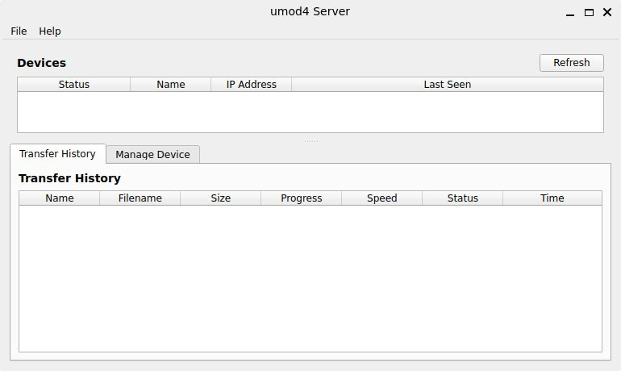

**Checkpoint:**

* Server window opens and shows an empty device list

## Install the WP software

The software installation procedure described in this section can **always** be used to recover a umod4 in the extremely unlikely event that it loses its ability to be flashed via WiFi.
The ability to flash a WP using a USB cable is built into the Pico2W boot ROM.
This is what makes a umod4 "unbrickable".

### Prep

Installing umod4 software the first time must be done using a PC and a micro USB data cable that connects the WP to the PC.
After the software is installed the first time, all subsequent updates can occur OTA (Over The Air) via WiFi.

The first step is to obtain binary files for:

1) WP_erase.uf2
2) WP_partition.uf2
3) WP.uf2
4) EP.uf2

The first 3 will be installed via USB cable.
The EP.uf2 will be installed by the umod4 server application via WiFi (see [Install the EP software](#install-the-ep-software)).

The ECU stays on your workbench for this step and the next two.
It does not go back on the bike until [Install the ECU on the bike](#install-the-ecu-on-the-bike).

For now, do not install the SD card.
It is not harmful if you accidentally have one inserted, but the instructions below assume that it is not present.

### Installation

Installing software via USB cable is easy.
Begin by making sure that the PC end of the cable is unplugged.
Find the 'BOOTSEL' button on the Pico2W.
It is the only button on the board, located near the USB connector:

* press and hold the BOOTSEL button
* while continuing to press BOOTSEL, plug the other end of the cable into your PC

Within a couple of seconds, a new mass storage device named "RP2350" will appear with exactly two files on it:

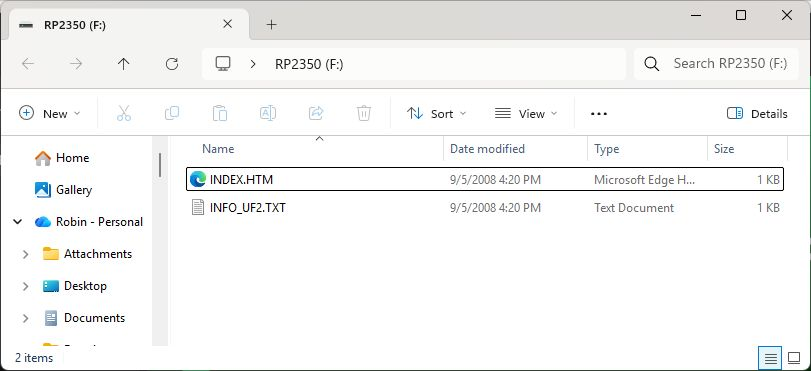

If you do not see the RP2350 Mass Storage window, make sure that you are using a USB *data cable*, not just a USB power cable.
Unplug the USB cable at the PC, then try again.

The RP2350 Mass Storage mode is very special.
If you drag a .uf2 file to an RP2350 in Mass Storage mode, the RP2350 chip does not copy the file, it programs the RP2350 flash memory with the *contents* of the .uf2 file.

### Erase WP

Using your PC's normal file explorer, drag the file "WP_erase.uf2" onto the RP2350 mass storage device.

Copying this file to the RP2350 device serves to load and run a program on the Pico2W that completely erases its entire flash.

On Windows, this may cause a pop-up saying that the file might be harmful.
Click "OK".
The mass storage window will close after about 1 second.
It takes the flash eraser program about 10 seconds to run.
When it finishes, a new RP2350 mass storage explorer window will open.

### Partition WP flash

Using the file explorer, drag the file "WP_partition.uf2" onto the RP2350 mass storage device.

Copying this file to the RP2350 partitions its flash memory so that future WP firmware updates can be done safely via WiFi.

Again, if there is a Windows warning about the program being harmful, just click "OK".

The partition program loads and runs basically instantly, which seems to cause some issues with Windows.
Sometimes, the explorer window closes and reopens just like the erase flash step, above.
Other times, the explorer window will close, but not reopen.
If it does not reopen, open a new explorer window and look at the "This PC" pane on the left.
You should see the RP2350 mass storage device still sitting there.
Click on it, and it will reopen a new RP2350 mass storage device explorer window.
If for some reason, the RP2350 is not showing up under "This PC", unplug the USB cable from the PC, press and hold BOOTSEL like before while plugging the USB cable back in.

### Install WP software

Using the file explorer, drag the final file "WP.uf2" onto the RP2350 mass storage device.

This time, the file is big enough that you will see the explorer open a copy progress window as the file gets flashed onto the RP2350.

When this file transfer completes, the WP will reboot and start running umod4 software.

### Initial state

You will know that the umod4 is running because the LEDs on the board will light up or flash through color changes.
There are two important LEDs to check, the WiFi status LED and the filesystem status LED.

The WiFi status LED is the small green located near the WP's USB connector.
At this point, it will be slowly blinking: 1 second on, 1 second off.
This slow blinking indicates that WP does not know your home WiFi's name or password.

You will also see the RGB LED located right beside the CN1 pins glowing red.
This is the filesystem status LED.
The red color tells you that there is no SD card mounted in the umod4.

### SD card installation

**WARNING: if your card was formatted for use on a PC, inserting it into a umod4 will cause the card to be reformatted without further warning, erasing all data on the card!**
If the card was already formatted for use on a umod4, inserting it is completely harmless: all the old umod4 files will remain untouched.

If you are OK to erase any Windows data from your card, you can insert the SD card now.

The WP supports hot-plugging the SD card, so there is no need to unplug the WP from USB power.
As the card latches in place, the WP will detect it.
The led that had been red will cycle through a few colors as it prepares the card for use and formats a new filesystem.
After about 1 second, the LED should end up glowing in a nice magenta color.
Magenta indicates that everything is in order.
Anytime you look at that LED from now on, you want to see magenta!

Feel free to check the hotplug operation at this point: push the SD card in to eject it.
The LED will immediately turn red indicating "no card detected".
Reseat the card.
You will see the LED color cycle end up at magenta again.

**Checkpoint:**

* Green WiFi status LED is slowly blinking (1 second on, 1 second off)
* Micro SD card inserted
* RGB filesystem status LED is glowing magenta

## Provisioning

The umod4 software is installed, but the umod4 does not yet know your home WiFi, and it has no name of its own.
Telling it these things is called "provisioning".
In this step you will give your umod4 a name and a strong password for its own WiFi network, and you will tell it how to join your home WiFi.
When you are done, you can reach your umod4 from any phone or PC on your home network, and the umod4 server will be able to find it.

You can use a phone or a laptop with a wifi interface.
The instructions here assume you use a phone, but they work the same for a laptop.

If a umod4 cannot access your own home WiFi for any reason, it automatically creates its own WiFi network.
This is called Access Point mode, or more simply, AP mode.
The provisioning process uses the umod4's own WiFi network to tell it how to connect to your actual home WiFi network.

Open your phone's wifi settings and scan for nearby WiFi networks.
You will see one called "umod4_XXXX".
The XXXX will match the last 4 digits of your umod4's MAC address.
In the example below, the umod4 AP-mode network shows up as "umod4_1EA3":

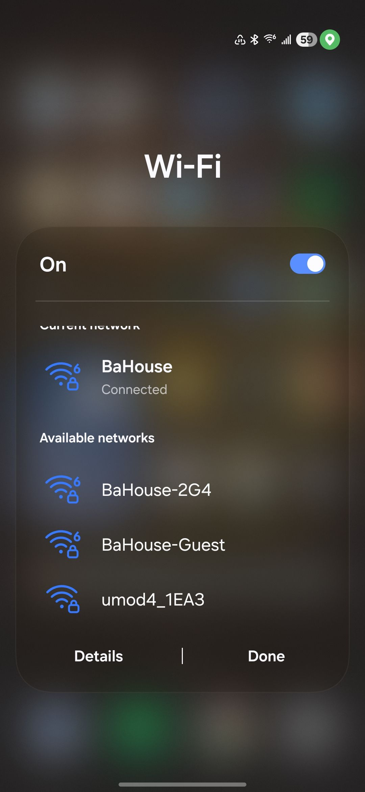

Ask your phone to connect to that WiFi network.
The default password is exactly the same as the WiFi name/SSID (case is important!).

Your phone may complain that the new wifi connection has no internet access and discourage you from connecting to it.
That's OK, connect to it anyway:

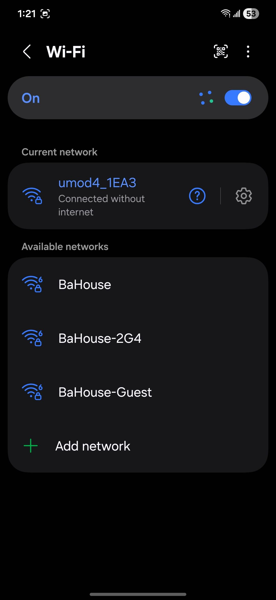

Once connected, open a web browser on your phone.
In the address bar, navigate to the following IP address: ``192.168.4.1``.

You will see the umod4's configuration page:

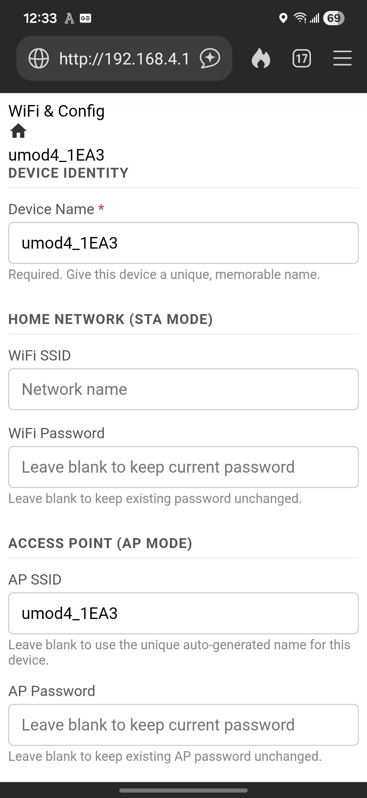

Pick a new name for your device.
Keep the name simple: no unicode or emoji chars!

The section titled "HOME NETWORK (STA MODE)" is where you enter the credentials for your home network.
Enter your network name and its password in the proper boxes.
Do NOT hit "Save & Reboot" yet.

Next, you can change the umod4's AP network name to something more memorable if you want.
But even if you do not change the AP network name, you **MUST** give it a new, **strong** password: **this network will get broadcast wherever your bike goes!**

_FYI: it is easy to change the AP Network name and password later so don't freak out about picking the best name possible right now._

Once you have entered all the configuration fields, click on "Save & Reboot" at the bottom of the page.

You should see a new page on the phone saying that it is now connecting to the home network.
The WP will reboot.
This time, the WiFi LED should come solid (no more slow-flash) meaning that the WP is connected to home WiFi.

When the WP reboots, your phone will lose its connection.
Most phones will automatically reconnect to your home network once the WP access point disappears at reboot, but you might need to make sure.

At this point, your umod4 is on your home network.
This means you can talk to it from any phone or PC on your home network.

On your PC or phone, open a browser and type the following, replacing 'Tuono' with whatever you named your umod4:

```text
http://Tuono.local
```

*If your browser cannot find that name, you can always use the umod4's IP address assigned by your router instead.
You can find it in your router's list of connected devices.*

You will see your umod4's home webpage.
It may look a bit different than this as the WP firmware has evolved since this screenshot was taken:

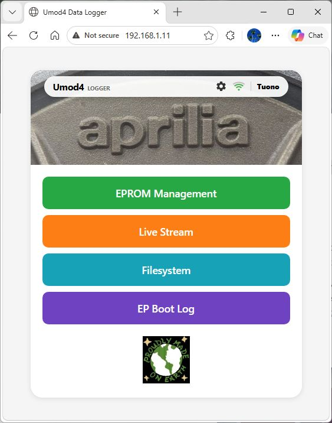

Feel free to click around a bit.

**Checkpoint:**

* The WiFi LED is solid (not slowly flashing) indicating it is connected to your home network
* You can use a browser to access your umod4's home web page from a phone and/or a PC

## Install the EP software

Now that the WP is on your home network, the umod4 server can install the EP firmware over WiFi.

* If the server from [Set up your PC](#set-up-your-pc) is no longer running, start it from a terminal (on Windows, a WSL terminal):

```bash
~/projects/umod4/tools/server/run_server.sh
```

* Wait for your device to show up in the server's device list.
The device's name is the one you chose during WiFi provisioning.
* Click on your device's name to select it
* Click the `Manage Device` tab, just below
* Click `Reflash EP`.
* Choose your `EP.uf2` file (the one you put in your home directory, or `~/projects/umod4/build/EP/EP.uf2` if you built it yourself).
* Confirm the warning, and do not power off the device until the server reports success.

The server uploads the firmware to the WP's SD card.
The WP then reads the EP firmware file and flashes the EP using the EP's SWD connection: a hardware debugger port.
Programming via SWD makes the EP "unbrickable": a WP can *always* reflash an EP using SWD.

When it completes, the EP is running the new firmware and the umod4 is ready to go.

You will know that the EP firmware is running because the BSY LED located at the far right corner of the umod4 will start flashing very brightly 2 times per second.
This is the EP telling you that it is ready for action but the ECU is not powered.

### Device management

With your umod4 still selected on the `Manage Device` tab, try out the other buttons and see what they do.
Specifically, check out the `Manage Files` button.
It will show you the files in the filesystem on your device.
You will see a file `EP.uf2` which is left over from reflashing the EP.
You will also see at least one log file of the form `log_N.um4`, where N is a number.
The log file will contain ECU and GPS data, if available.

Every time the WP reboots, it creates a new log file where the `N` in its name will be 1 higher than the highest existing log file in the filesystem.
If a umod4 is powered off, turning the ignition key ON or plugging the umod4 into a USB power supply will both create new logs.

Files displayed in dim grey text are system files that you should leave alone unless you know what you are doing.

To see how the interface works, you can select the `EP.uf2` file, then click `Delete Selected`, then click 'OK' when asked.
The file list will refresh with EP.uf2 missing.
In normal use, you don't actually have to delete the file.
This is just a test to show how things work.

**Checkpoint:**

* The server shows your device in its device list with its proper name
* The EP software update using the server completed successfully
* The BSY LED is flashing 2 times per second
* The server's `Manage Files` control lets you successfully delete the `EP.uf2` file
* `Manage Files` shows you at least one `log_N.um4` file

## Install the ECU on the bike

At this point, all further software updates will occur OTA via WiFi.
You are done with the ECU on the bench!
The final steps would be to attach an active antenna to the GPS and double-check that you have a micro SD card installed.
It is possible to swap micro SD cards with the ECU on the bike, but it is not convenient!

Reinstall the ECU in the motorbike and reconnect the two big wiring harness connectors.
Remember that the ECU top cover will not fit anymore due to the height of the WP on top of the umod4.

Even if you have not installed your own preferred .bin file, turning the ignition on will cause the built-in UM4 code to prime the fuel pump and shut off a couple seconds later, just like normal.

That's your feel-good moment: it means that the EP booted, constructed the built-in ECU image for the ECU, then booted the ECU.
If you hear your fuel pump cycle on then off like normal, it means that the ECU correctly executed a few million CPU cycles using the umod4 as its EPROM!

**Checkpoint:**

* Verify that micro SD card is installed
* Verify that the GPS antenna is attached
* ECU is installed back onto the bike
* Turn ignition ON and listen for the normal fuel pump prime cycle

## Garage setup

The final step is to prep your garage.
The umod4 will need power and WiFi out in the garage.

### Garage Power

I recommend leaving your umod4 powered via USB cable at all times when the bike is in the garage.
You don't actually _need_ to power the umod4 24x7, but without power, it will have no wifi connection, so no OTA updates, no automatic log file downloads, etc.

My technique is to leave a 4-foot micro USB data cable permanently plugged into the WP's micro USB socket.

When I go for a ride, I coil the cable under the seat.

When I get home again, I put the Tuono on its battery maintainer, pop the rear seat, uncoil the umod4 USB cable and plug it into a USB supply near the bike.
The umod4 will come to life.
The EP will flash the BSY LED at 2Hz because the ECU has no power.
The WP will mount the SD filesystem and turn the RGB LED to magenta.
At the same time, the WP will ping the server, telling it to work downloading the new ride logs.
The disk activity LED will flicker as the logs get uploaded.

### Garage WiFi

This might be tricky for some.
I am lucky to have a WiFi access point mounted on my garage ceiling with an Ethernet cable that runs back to the router in my house.
My WiFi is perfect out there!

If you do not have good WiFi signal in your garage, other options might be:

* Powerline adaptors to get Ethernet to the garage, then an access point plugged into the powerline adaptor
* point-to-point WiFi bridge devices to get signal to the garage

You do **not** need blazing fast WiFi: it just needs to be reliable.
The umod4 only needs 2.4GHz 802.11N.

**Checkpoint:**

* With bike in garage, umod4 & ECU on bike, umod4 powered via USB power supply and cable, and umod4 within WiFi range of your home network: verify that the server can see the umod4 on the bike
* Prove that the remote WiFi connection works by using the server to reflash the EP and the WP using the original WP.uf2 and EP.uf2 files

## Installation complete!

At this point, installation is complete.
Further interactions with the umod4 will be as a rider and a user.

For starters, you would need to define what EPROM image you want the bike to run when you turn it on.
The User Guide explains how: see [Choosing what the ECU runs](./USER_GUIDE.md#choosing-what-the-ecu-runs-eprom-images).
Before you ride on a new image, read the [safety advice](./USER_GUIDE.md#safety).

And finally, you can go riding again!
The User Guide also describes [the routine of riding, collecting and looking at your logs](./USER_GUIDE.md#the-routine-ride-collect-look).

## Appendix A: Building a board from scratch

If your umod4 is not "as shipped" (see [Parts](#parts)), then depending on how many parts were installed at the PCB assembly house, you might need to install a few final parts on the board yourself.

### SIP Sockets

**Reminder: ALL SIP sockets on the umod4 are meant for 0.020 round pins, not 0.025 square pins!**

#### Pico2W SIP Sockets

The Pico2W module needs a pair of 20-pin strips.
To ensure proper spacing and alignment of the two SIP sockets, use a spare socket strip inserted between the two strips as a spacer jig, and a rubber band to hold the strips flush to the PCB:

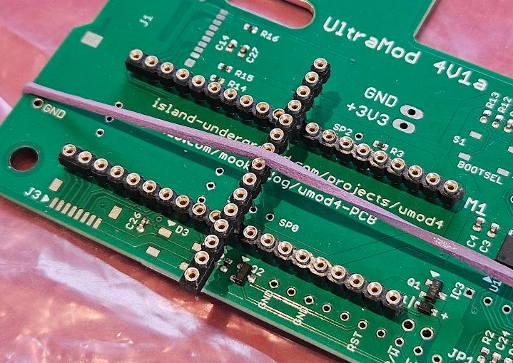

The spacer that spans the two strips keeps the strips to be soldered perfectly spaced and perfectly vertical.
The rubber band holds them flush to the PCB.
Turn the board over and solder them up.
Do a visual inspection!

#### GPS Socket

Reuse the rubber band to attach the GPS socket:

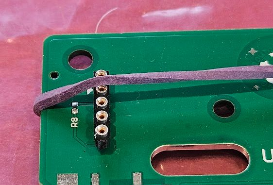

Lightly stretch the rubber band one way or the other to get the strip as vertical as you can, then flip the board over and solder pin 1.
Remove the rubber band and inspect it.
If you need to adjust it, now is the time.
Once you are happy, solder the rest of the pins.
Do a visual inspection!

### Square Pin Headers

The square pin headers are only used for hardware test and software debugging purposes.
There is no need to add them unless you want to get deep into the embedded SW/HW development world.

They are meant for standard 0.1 inch spacing 0.025" square pin header strips for:

* +3V3, GND (2 pins): allows for easy measurement of power & GND
* EP SWD (3 pins): allows connecting a debugger to the EP
* BSY (1 pin): allows a scope or logic analyzer watch the timing of the fake EPROM cycles

Also: if you ever want to connect a debugger to the WP, you should add a 3-pin right-angle header to your Pico2W module as shown below:

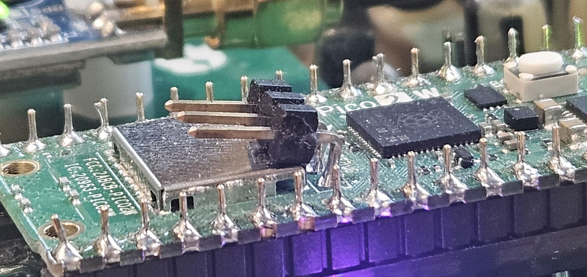

Before soldering, I mechanically wedge the connector with something squishy to get the horizontal pins to angle up slightly.
I find that the slight upwards angle makes it easier to attach on the debugger's "squid pins" for a debug session.

### Test Points

Again, you really don't need to add the test points unless you will be doing hardware testing or development.
But if you do, I like using [Keystone 1035](https://www.digikey.com/en/products/detail/keystone-electronics/1035/315151?s=N4IgTCBcDaINYFMCeBnALgewHYIAQEYAGAZgFYQBdAXyA) parts for GND test points, as seen below:

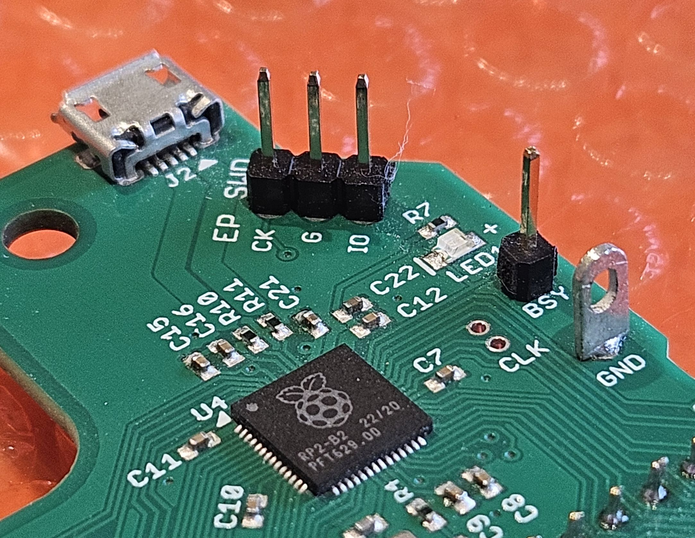

If you don't feel like getting the specific Keystone parts, 0.025 square header pins work well too.

## Appendix B: Parts and sourcing

### Round-Pin SIP Sockets

SIP sockets come in strip form.
There are many choices out there.
DigiKey part #[25-0513-10](https://www.digikey.com/en/products/detail/aries-electronics/25-0513-10/4298) is very high quality.

Here is a detailed dimensional drawing of that part:

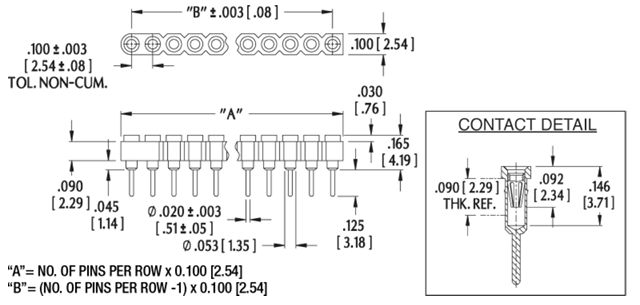

The key specs on the connector:

* height from PCB to top of socket 0.165 inch
* 0.1 inch pin spacing
* 0.020 pin diameter
* gold plated contacts

Do not get connectors that are much different in height!
I would say no more than about +- 10 thousandths difference in height, max.

These ones come in strips of 25 pins and can be cut to length.
Use good quality flush-cutters to cut them!

You need two 20 pin strips for the Pico2W, one 12 pin strip for the CN1 connector, and a 5 pin strip for the GPS mount.
That's 57 pins worth, or three of the 25-pin strips.
I would get a couple spares though because sometimes when you trim them, the plastic fractures leaving the pin on the end without enough support.

### Round-Pin Male-Male Interconnect Strips

The male-male interconnect strips that allow the umod4 to plug into the ECU sockets are harder to find.

The pins should be round, approximately 0.020 in diameter.

These ones from DigiKey (ED6864-64-ND) are very high quality: [Mill-Max 350-10-164-00-006000](https://www.digikey.com/en/products/detail/mill-max-manufacturing-corp/350-10-164-00-006000/357045?s=N4IgTCBcDaIMwFYAMBaAjKtA2ALCpqBWBSIAugL5A).

They come from DigiKey in strips of 64 pins and can be cut to length.
Two 64-pin strips are enough: the system needs 28 for the EPROM, 12 for CN1, 5 for the GPS module and 40 for the Pico2W, for a total of 85 pins.

I have also used male-male interconnect strips from LCSC, part number [C2764600](https://www.lcsc.com/product-detail/C2764600.html?s_z=n_q_C2764600&globalKeyword=C2764600).
These ones worked well, too.
Note that these strips are only 20 pins long, so make sure to get enough.
Again, get some spares in case something bad happens as you trim them to length.
