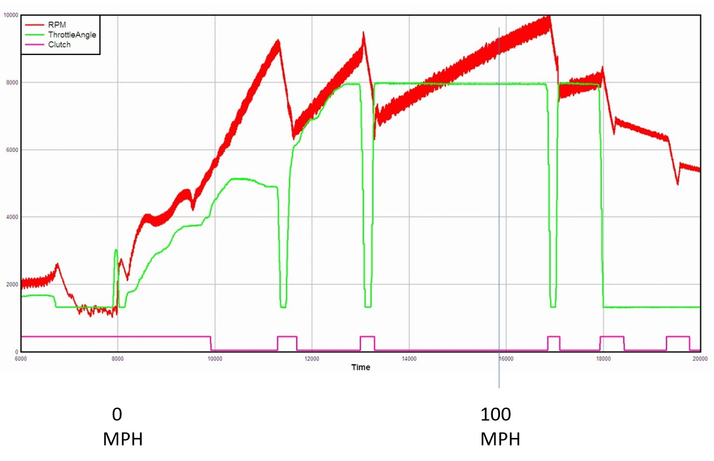
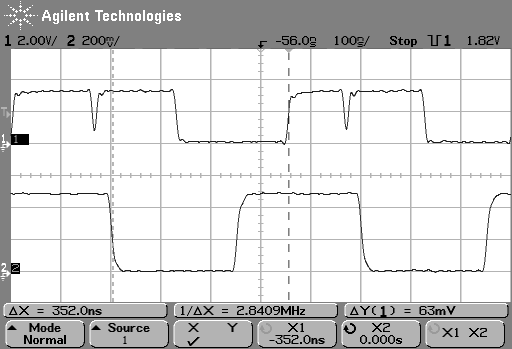

# Umod4 History

This page tells the story of how the umod4 came to be.
If you just arrived here via a search engine: the umod4 is a data logger for Gen 1 Aprilia fuel-injection ECUs.
See the [project README](README.md) for the overview, or [WHY_UMOD4.md](WHY_UMOD4.md) for what it does for a rider.

This project has been ongoing since about 2004, starting with my original "UltraMod" project.
It began as a project to reverse engineer how the fuel injection system worked on my spanking new 2003 Aprilia Tuono.
To make a very long story short, it was pretty successful and I had a ton of fun figuring things out.

Along the way, "figuring things out" turned into a project that allowed me to stream real-time ECU data out of the fuel injection computer.
The ECU data stream was then combined externally with a GPS position and velocity data stream, giving me my own personal racing datalogger.

One result from that work is an annotated version of the original ECU codebase.
Obviously, it is my interpretation of what is going on inside the ECU codebase, and it is not complete.
But if you have ever had the desire to stare at some impenetrable 68HC11 assembly code, check out the [ECU source code](ecu/src/UM4.S)!

Once the version 3 hardware was working back in the 2006-ish timeframe, I had to go riding.
Here is a graph generated from a datalog from way back when.
For this graph, the only data I included was RPM, throttle position, and the state of the clutch switch.
It shows me doing a 0-100MPH run using an UltraMod V3, the predecessor to the current umod4 project:

You can learn many things from that data log.
Mostly, it proves that I'm slow: it took me about 8 seconds to go from 0 to 100MPH.
A better rider than me would have given it a lot more throttle (green trace) in first gear.
You can see I was modulating the clutch around 4000 RPM or so.
A better rider would probably have been using a higher RPM and might have slipped the clutch a bit longer before letting it lock up.
It took me forever to get the throttle wide open in second gear.
I was shifting at about 9500 RPM (1000 RPM below redline, not optimal!) and clearly, my shifts are slow.
It's all proof as to why my day job was in software, not as a drag racer.

The RPM (red trace) is called the "instantaneous" RPM.
It may look surprisingly thick and ragged, if only because the rate at which the crank turns is surprisingly variable as it goes through even a single rotation: slowing down during a compression stroke, speeding way up during a power stroke.
Those effects are more pronounced at larger throttle openings.
When I closed the throttle at the end of the run, you can see that the RPM becomes more consistent (the line gets thinner).
The tachometer on the dashboard filters out these rotation speed changes.
It basically shows a rider the average RPM over the last few rotations.

## Why a Version 4?

The original boards worked, but were limited by the low-end processor chips available in that era.
In addition, the original designs replaced the 32K EPROM with flash.
That meant in-system upgradability, but the flash device could still only hold a single EPROM image.
The design I had always imagined for the EPROM replacement was a cheap processor that ran fast enough that it could simply *pretend* to be an EPROM.
Turning the EPROM into a software construct would enable a whole slew of elegant simplifications in the system software.
For example, I would be able to use the processor's own flash memory to hold multiple EPROM images and get rid of the standalone (and obsolete!) flash chip from the earlier version.

All I had to do was wait for Moore's Law to catch up.

And it did!
The Raspberry Pi people released the RP2040 'Pico' controller in early 2021.
For a cost of $1, I could buy a dual-core ARM processor running at 125 MHz.
In simple terms, the RP2040 had more than 4 times the CPU power of the original boards.
That got my attention!
It was super interesting, but with one major problem: not enough IO pins.
After emulating the EPROM, there would not be enough IO pins left over to do other important things like talking to the GPS, or connecting to an SD card.

Definitely a case of "close, but no cigar."
I parked the idea of a version 4 yet again.

Until one day, when the Raspberry Pi people released the Pico W: a processor module using an RP2040 chip in conjunction with an on-board WiFi interface.

I mean, adding WiFi would be AMAZING!
That begged an obvious idea: what about using a bare RP2040 as fake EPROM, and a Pico W board to supply WiFi and IO for the SD card and GPS?

That would certainly make the system more complex.
But one huge simplification would be that the PicoW used the same RP2040 CPU as the proposed fake EPROM.
That meant the same development system, same SDK, same *everything*.
Given that modern processor chips may come with thousands of pages of documentation, this would be a huge timesaver.

And that was enough to push me over the edge to take a serious look at a version 4.
It would all come down to one question: would an RP2040 CPU be capable of emulating EPROM timing on a 2MHz CPU bus?

## Proof of concept

The timing question would be best answered with a hardware proof of concept.
I dropped $4 on a Pico development board and started writing some ARM assembly language emulation code for a software-based "Fake EPROM".
It was strictly a timing exercise: the Pico board did not have enough accessible IO to emulate an actual EPROM.
As a result, I think my emulated EPROM only implemented 8 address and 8 data bits.
In truth, implementing just one of each would be enough to prove that I could sample the address bus at the right time, or turn the data bus around as needed.
An oscilloscope was all I needed to prove whether I had a solution.

It took a while, but my scope provided the proof.
The RP2040 had the horsepower to get it done:

*External bus timing for an HC11 write cycle*

In the scopeshot above, the first vertical marker shows the falling edge of the HC11 E clock (bottom trace).
The falling edge of E marks the start of a new bus cycle.
The top trace is a firmware-controlled debug IO line named "DBG_BSY".
The firmware drives DBG_BSY high and low during each bus cycle.
The changes on DBG_BSY give me timing information for the critical firmware operations that occur during a bus cycle.
In this case, the first falling edge of channel 1 (the top trace) after the falling-E marker shows me the precise moment that my code sampled the HC11 bus signals after being woken from sleep.
At this point, the firmware can figure out if it needs to respond to this bus cycle.
In this case, it does need to respond because the HC11 is writing some data to be logged.
The second marker shows the rising edge of DBG_BSY.
This is the firmware showing me the precise moment that it is sampling the write data.
When the firmware finally completes processing a bus cycle, it signals the scope by creating a short low-going pulse on the top trace.
This pulse must complete before the next falling edge on E (bottom trace).

## The umod4

The success of the proof-of-concept code marked the start of the umod4 project.
It would be a complete redesign: hardware, software, *everything*.
The software was a total rewrite: not a single line of code carried over.
For the circuit board, the only things that carried over were mechanical: the general shape of the board and the locations of holes that needed to line up with the ECU.
Fortunately, I really like laying out circuit boards.
It was all done by hand.
I like to think that people can still do a better job than autorouters!

In time, I got the new design working and fabricated.
The software took the longest time.
But the software proved that the new approach would do everything I had imagined it would.
I finally got my EPROM image libraries, an elegant method of capturing log writes from the HC11, all the good stuff.

Since the first umod4 PCB revision, the PicoW module was upgraded with a Pico2W module.
It was a drop-in change that gave me a new WiFi processor based on the faster, more capable RP2350 processor.
The new Pico2W made WiFi OTA code updates easier to implement, a major feature for this project.
It's a perfect example of why the choice to use a plug-in processor module was a win: I literally unplugged the old PicoW and plugged in the new Pico2W, changed a small amount of software, and was running again that same day.
If they ever come out with a pin-compatible "Pico3W" module, it's going in as soon as I can get one!

In contrast, the umod4 board *could* be redesigned to replace the RP2040 "Fake EPROM" processor with a faster, more capable RP2350 processor.
It's just not worth it at the moment: the existing RP2040 does the job perfectly and its low-level software is proven.

At this point, I think the umod4 hardware will be the end of the line.
There might be a tweak or two in the future, but I can't see any major changes on the horizon.

But if this project has taught me anything, it's that you just never know...

