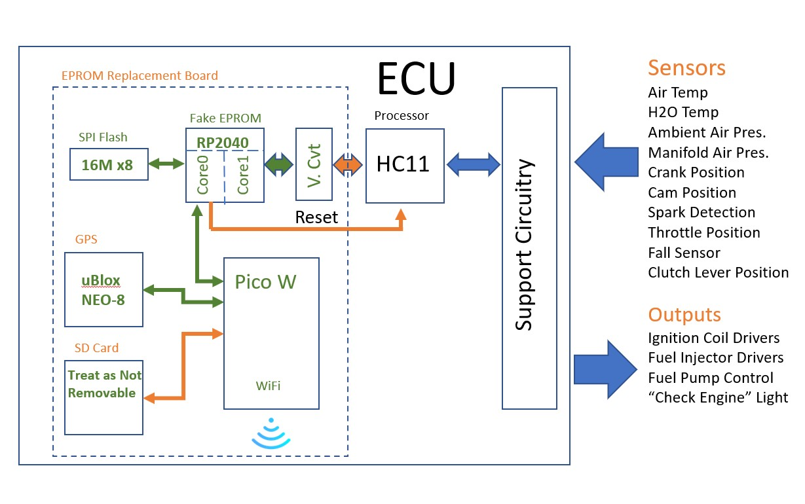
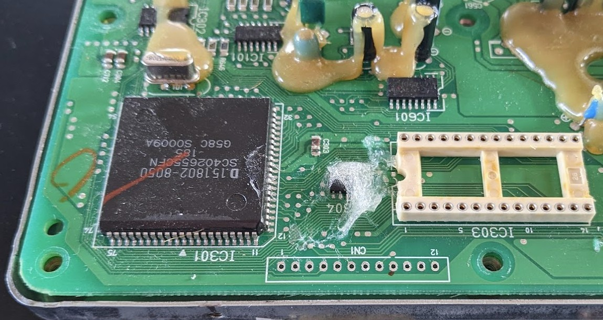
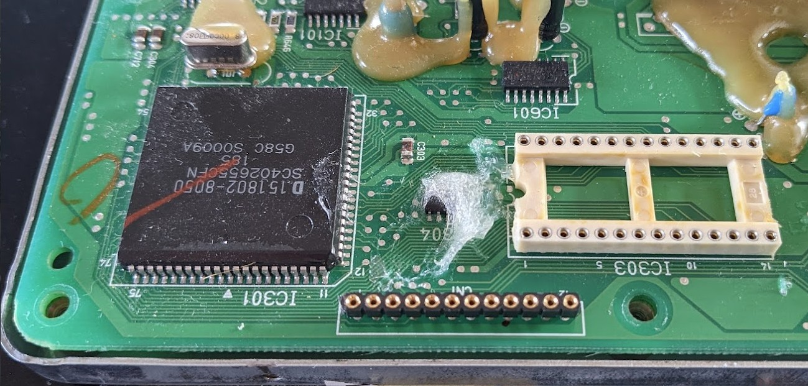
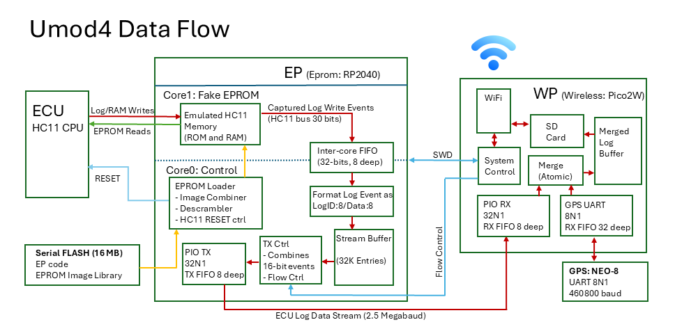
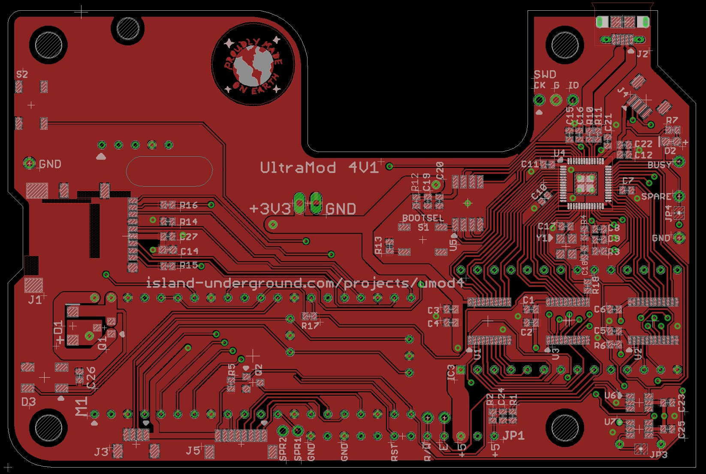

# How The Umod4 Works

This page explains what is inside a umod4 and how it all works. It will cover the umod4 from its conceptual viewpoint down through the system's data flow and high-level electrical power considerations.
If you just want to know what a umod4 does for a rider, start with [WHY_UMOD4.md](WHY_UMOD4.md).
If you want to build one, see [GETTING_STARTED.md](GETTING_STARTED.md).

## Opening a closed system

To run the engine, the ECU already measures everything a datalogger would want: throttle, RPM, temperatures, spark and injector timing, to name just a few.
What stands in the way of datalogging all this information is that the ECU is a closed system: there is no output mechanism to get the data out.

The umod4 datalogger project opens this closed ECU system by giving the ECU a new high-speed output mechanism, then modifying the ECU firmware to use it.

It starts with a umod4 circuit board that plugs into the ECU's EPROM socket.
Special circuitry on the board makes it act exactly like an EPROM, but with one critical difference: unlike a read-only EPROM, the umod4 permits the ECU's HC11 processor to write data to it.

Conceptually, it's a simple process: as the ECU firmware takes sensor measurements and makes its control decisions, the firmware is modified to write these results to the umod4 for logging.

## Warning

The ECU firmware changes required by the project are both tiny and targeted: they *should* have no effect on engine operation.
That said, **any** change to the ECU firmware has a risk that the ECU might misbehave under circumstances not encountered during testing.

**ECU misbehavior could have extremely serious outcomes for a rider.**

**Bottom line: Use a umod4 at your own risk.**

## System details

The block diagram below shows the major pieces of an ECU with a umod4 PCB installed in it.



The umod4 board adds a pair of processors to the overall system.
The first is called the "EP" (EPROM Processor), or "Fake EPROM" as in the drawing.
The EP has two main jobs:

* simulate EPROM operation using Flash and SRAM (allows in-system reprogramming!)
* provide a high-speed output mechanism for ECU firmware

Pretending to be an EPROM uses up almost all the IO pins on the EP processor chip.
It means that the SD card logging and system control needs to be performed by a second new processor on the umod4: the "WP" (Wireless Processor), shown as "Pico W" in the drawing.
Note that the PicoW module has been replaced with a Pico2W module in the most recent umod4 builds.

The datalogging system functions as follows:

* ECU firmware writes data describing the most recent ECU event to the EP
  * These events could have something to do with any of the ECU sensors or outputs listed on the right, among others
* The EP receives the data from the ECU, then immediately forwards it to the WP over a high-speed serial bus
* The WP combines the incoming ECU data event stream with another stream of location and velocity data from an on-board NEO-8 GPS module
* The combined data stream is then written to a logfile on a micro SD card

In addition to datalogging, the WP also provides a WiFi interface to the umod4.
This allows users to do things like update their device firmware (ECU, EP, and WP) over WiFi, or control umod4 operation via their phone.

The "V. Cvt" block represents a set of 3 voltage conversion chips.
They are required to convert between the ECU's legacy 5V bus logic and the EP's more modern 3.3V logic levels.

The SPI flash contains the EP code, along with an ECU EPROM image library.

Finally, the umod4 can control the RESET signal into the ECU's HC11 processor.
This allows the EP to load an EPROM image from the image library in a few tens of milliseconds after a rider turns the ignition key on.
The delay is imperceptible to a rider.

## ECU hardware modifications

In a perfect world, it would be enough to just plug the umod4 into the EPROM socket.
Unfortunately, this is not the case: the EPROM socket does not have a connection to the RESET signal, for example.
Fortunately, all Gen 1 ECUs have an unused 12-pin connector on them, located right by the EPROM socket, labeled "CN1":



It's possible that the manufacturer used this connector during their development of the ECU.
Regardless, CN1 has everything the umod4 needs:

* two extra +5 Volt power pins
* two extra ground pins
* the HC11 RESET signal
* the HC11 R/!W signal: it defines if a bus access is a READ or a WRITE
* the HC11 'E' clock signal: it defines the precise timing for an HC11 bus operation

To access these signals, the umod4 project requires that a socket be soldered into CN1.
If you have soldering skills, it is not hard.
This shows the result of adding the required SIP socket to CN1:



## ECU code modifications

Any time that changes are made to a real-time embedded system, there is a potential that the change could expose a latent bug in the original system, or introduce a new bug due to a change in timing, for example.
This project requires making unavoidable changes to the original ECU code.
The umod4 attempts to make these changes absolutely as short and fast as possible for minimal impact on the original ECU code timing.

The new datalogging codebase containing these changes is named 'UM4'.
Here is an example from the ECU's UM4 datalogging source showing how it works.
`IC1F_ISR` is the name of an interrupt handler in the ECU firmware.
It runs every time the camshaft sensor triggers (once every 2 crank rotations).

The UM4 code modifies the original IC1F_ISR code by adding the two lines that start with a '+':

```diff
 IC1F_ISR:
+        ldD     TIC1            ;Log the timestamp of this most recent camshaft event
+        stD     LW+LOGID_ECU_CAMSHAFT_TYPE_TS
         ldaA    TCTL2           ;read TCTL2
         andA    #0b00110000     ;only interested in the T1 edge control bits
         cmpA    #0b00100000     ;was it set to %xx10xxxx (T1 falling edge)?
         beq     1f              ;yes
```

Explanation:

* The first new line reads the 16-bit time when the cam sensor was triggered
* The second new line writes that 16-bit time to an address in the special 'logging' section of the EPROM address space
  * The specific address is used to define what *kind* of data is being logged
  * The data being written defines the *value* to be logged.
    In this case, the precise time at which the CAM event occurred

The two new lines add just 5 microseconds to the interrupt routine's execution time.

Other common logging situations involve logging data that is already sitting in a processor register.
In those situations, logging the data takes just 2 microseconds.

Takeaway: the UM4 firmware changes to add logging may not be *zero* impact, but they aim to be *low* impact.

## Data Flow

To understand the umod4 system more completely, it is worth looking at a detailed diagram showing how the data moves from the ECU through the umod4:



### EP operation

When the ignition key turns on and the EP boots, the umod4 board defaults to holding the ECU's CPU in reset so that it can't try to run.
This gives the EP time to get everything ready for the HC11.
The EP's core 0 CPU scans the serial flash and determines which EPROM images the rider wanted to run in their ECU.
The EP image loader code reads the EPROM images from SPI flash.
It combines logging code from a UM4 EPROM image and maps from another EPROM image.
The combined image is placed into EP SRAM where the EP core 1 will serve it to the ECU.
When both EP cores are ready, core 0 releases the HC11 RESET signal.
This allows the ECU to boot.

#### EPROM read operations

The vast majority of bus events that core 1 needs to service are simple EPROM read events.
Reads are easy: core 1 reads the HC11 bus address from its GPIO pins, looks up the EPROM data for that EPROM address in its SRAM image, then drives the read data to the HC11 data bus.

#### Logging write operations

In contrast to read operations, log write operations are far more complex.
Referring to the Data Flow diagram (above), a log write operation goes like this:

* When the ECU wants to log something, it writes it to a special section of the EPROM address space reserved for logging
  * The ECU processor can write log data with 8-bit or 16-bit values, but 16-bit writes are really just a sequential pair of 8-bit writes to sequential addresses.
* The EP core 1 detects an HC11 bus write operation appearing on its GPIO pins
* Core 1 tests if the write is targeting the logging address space window.
  If so, the bus transaction needs to be logged.
  Core 1 has no extra time to process the write data, so it does the simple thing: it sends over the entire 30 bits of raw HC11 bus data to core 0 using the inter-core FIFO, then lets core 0 sort it all out.
* Meanwhile, core 0 waits for data to arrive in the inter-core FIFO from core 1
  * If the FIFO is not empty, core 0 pulls the oldest entry from the FIFO and processes it.
    Core 0 extracts the log ID from the low 8 bits of the log address, combines it with the 8 bits of write data, and stores the 16-bit result in a stream buffer.
    As mentioned earlier, a 16-bit log write will show up in the stream buffer as a pair of sequential entries to sequential addresses.

Core 0 now needs to get the data out of the stream buffer and send it to the WP.
The WP has a 'flow control' signal that it can use to tell the EP if it is permitted to send data.

Assuming the EP is allowed to send data, there is one more step.
It adds a little complexity to the EP to make the WP's job much simpler.
It helps the WP greatly if the EP can transfer the logging events as a single unit, not as a sequence of bytes as would typically be done.
This turns out to be easy: the serial interface is set up so that each log event is transmitted as a single 32-bit transfer unit.
The EP reads the stream buffer, combining sequential pairs of entries into one 16-bit event as needed.
Both 8-bit and 16-bit log events end up as a single 32-bit value for the transfer.
This means that 8-bit events go out padded with zeroes, but at 2.5 megabaud the extra time is immaterial.

### WP operation

While all of those EP operations were happening, the WP is doing its own things.
The WP runs FreeRTOS, a real-time operating system.
This means that the WP can run many different tasks, which from a human standpoint appear to run simultaneously.

With regards to logging, one of the WP's main tasks is to watch for data to get logged to the SD card.
The data can come from 2 sources: the 32-bit ECU log events arriving from the EP serial interface, and position and velocity messages arriving from the GPS.
Because both the EP messages and the GPS messages arrive as complete chunks, it is easy to merge them into a single log stream.

Meanwhile, there is another WP task that watches the merged log buffer fill up.
When enough data has arrived, this task removes a bunch of data from the merged log buffer and writes it to the SD card.
The write to the SD card is actually a relatively complex operation, for reasons of data integrity.
If a write operation gets interrupted for any reason (like when a rider turns off the ignition key), the filesystem guarantees it will not get corrupted.
In the worst case, the most recent write will be lost, plus any remaining data in the merged log buffer.
Typically, this is just the final few seconds of data from an idling engine when the key got turned off.

The final step involves a WiFi task running on the WP.
This task can transfer files to and from the SD card, among other things.
It is the mechanism that allows the server running on a PC to download new log files after a ride.

## Powering umod4

The ECU's power is controlled by the ignition key, so the umod4 loses power with no warning whenever the key turns off.
The umod4 handles that in software: the SD card filesystem is designed so that a power loss event would lose the last few seconds of log data, but it would not corrupt what was already saved.
If the ignition were the sole source of umod4 power, it would mean that nothing could happen while the bike was parked: no log downloads, no firmware updates.
Fixing that needs a hardware answer, described next.

The umod4 takes advantage of the power supply built into the WP module itself, a Raspberry Pi Pico2W board.
The WP can take its own 5V power from multiple sources.
The umod4 circuitry arranges for two of them: ECU power (if the ignition is ON) or a USB cable plugged into the WP (if the bike is parked).
If interested, see the [PCB repository](https://github.com/mookiedog/umod4-PCB) for the power combiner circuit details.

The bottom line is that all a rider needs to do is connect the umod4's USB power to a USB AC adaptor after they park.
The umod4 will become fully operational for phone control or server access as long as USB power is present.

## Reflashing

Like any computing device, the umod4 needs a reflash capability to manage new software releases.
It is a bit more complicated than typical because the umod4 needs to be able to update firmware for 3 different processors: the ECU, the EP, and the WP.

Under normal circumstances, WiFi is used to perform the updates:

* a user can use the PC server application to push firmware updates for the WP or the EP
* the umod4 web interface can be used to install ECU EPROM images

All updates go through the WP because it contains the umod4's WiFi interface.
If for some reason the WP does not contain working code or its WiFi interface is non-responsive, it can be recovered with a laptop, even when the umod4 is mounted on the bike.

A key design capability for the umod4 is that it **cannot be bricked**.
A umod4 system can always be recovered using this sequence:

* The WP can **always** be reflashed using a laptop and a USB cable.
  This would be the same cable used to power it when parked.
* A working WP can **always** reflash the EP via the EP's SWD (Single Wire Debug) interface.
* A working EP means that ECU EPROM images can be installed and selected.

## Debugging

The WP and EP processors support standard ARM Cortex SWD debug interfaces.
The WP's SWD interface is available on the Pico2W module itself.
The EP's SWD interface is available on the umod4 PCB at the 3 pin connector silkscreened "EP SWD".

The umod4 software repository is set up with a set of debug configurations.
These configurations are set up to enable a developer to debug WP or EP software at the source code level.

## The Circuit Board

The board design is in its own repository, [umod4-PCB](https://github.com/mookiedog/umod4-PCB).



*The 4V1 version of the umod4 circuit board*

## Where to go next

This page is a general overview of umod4 operation.
The details live closer to the code:

* **Want to build the software or debug it?** See [BUILDING.md](BUILDING.md) and [DEBUGGING.md](DEBUGGING.md).
* **Want to know how one piece works in depth?** Each component has its own README:
  * [EP](EP/README.md): the EPROM Processor, the fake EPROM used by the ECU
  * [WP](WP/README.md): the Wireless Processor, which does the logging and the user interface
  * [ECU](ecu/README.md): the special data-logging firmware
* **Want to work with the logs?** See the [log decoder](tools/README_LogDecoder.md) and the [visualizer](tools/README_Visualizer.md).
