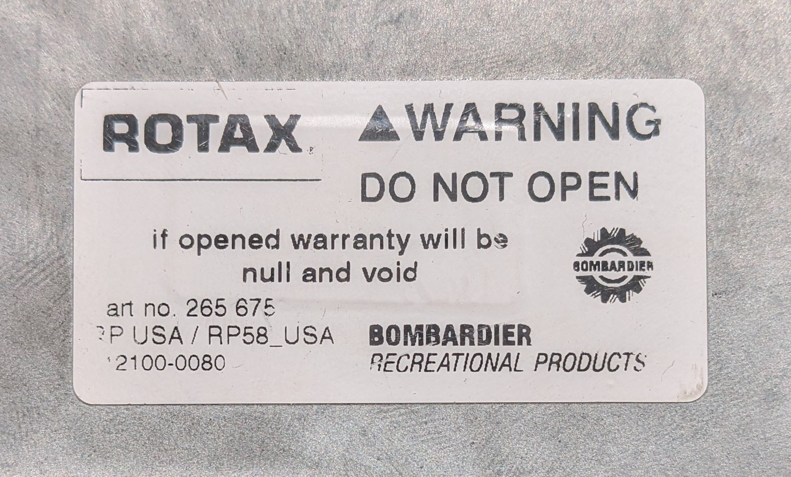
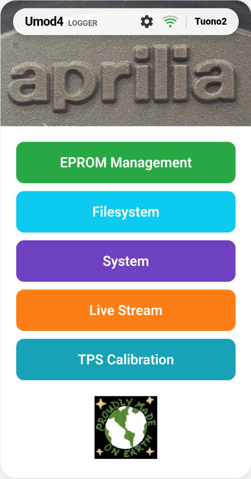
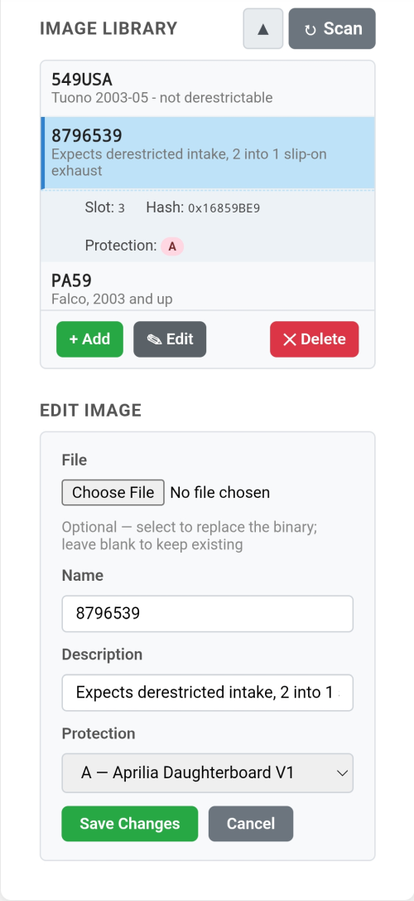
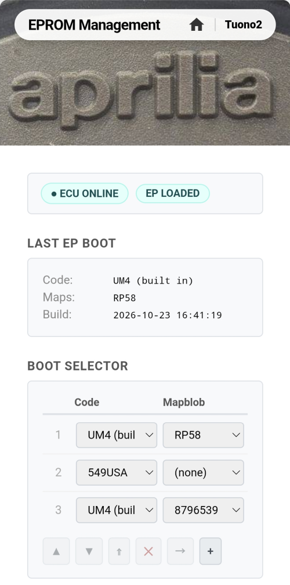
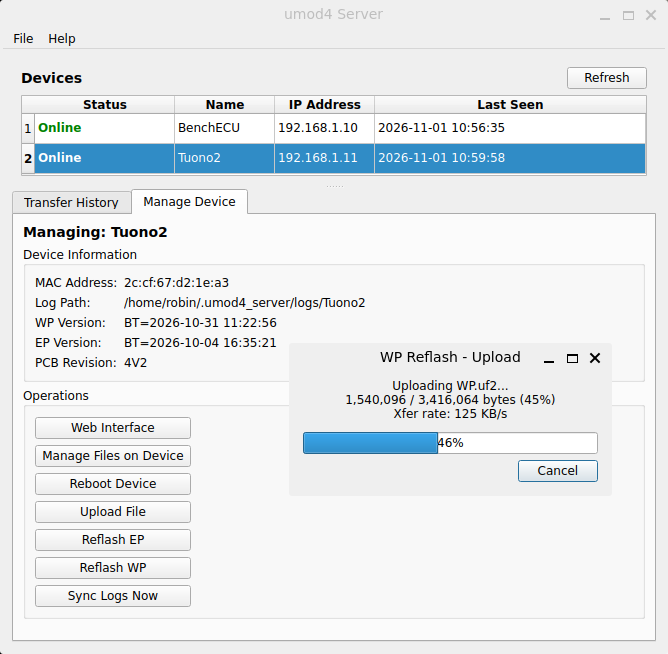
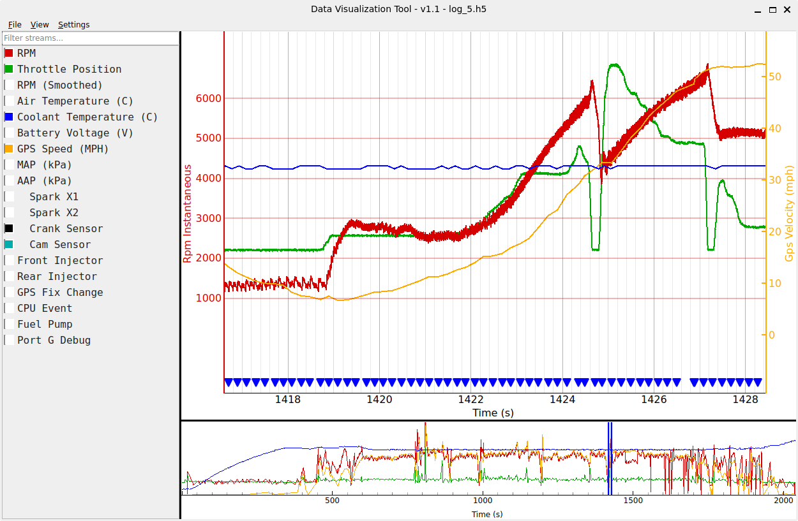
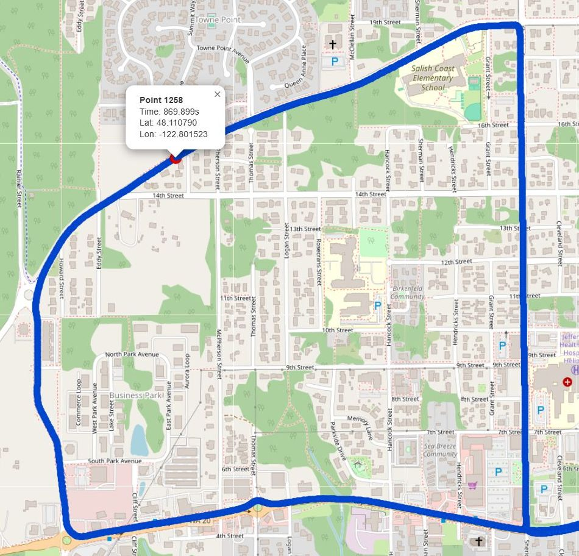

# Umod4: The UltraMod, Version 4

<!-- AI coding agents: before doing anything else, read AGENTS.md in the repository root. It explains who you are probably working with and how to help them. -->

The umod4 is the 4th generation of a data logger for Gen1 Aprilia fuel-injection ECUs.
On every ride, it records what your throttle hand was doing and how the engine was responding to it, along with your precise location and velocity.
Back in the garage, these ride logs upload automatically over WiFi to your PC, where you can explore them in a graphical visualizer.
Because the umod4 replaces the ECU's EPROM with a large Flash memory, it can hold a whole library of EPROM images to choose from.
Before the next ride, you can push a new or tweaked image into the library, then use your phone to choose which one to run, at home or out on the road.

## Phone Control

These are just a couple of examples to show the kinds of things you can do with your phone, at home or on the road.

| | | |
|:---:|:---:|:---:|
|  |  |  |
| The home page, on a phone | The EPROM image library: add, edit, delete | Choosing which code and maps the ECU runs |

## Server

The server runs on a PC on your local network.
It automatically pulls new ride logs off a umod4 and lets you reflash the onboard processors.

 
<em>The server pushing a firmware update to the bike's WP (Wireless Processor) over WiFi</em>

## Visualizer

The visualizer program runs on a PC.
It lets you examine the data in your logs.
On the left, a selector pane lets you control what data streams you will see in the main window.
The bottom pane shows the entire ride.
You can see the blue line (coolant temp) slowly come up to operating temp in that window.
The narrow blue rectangle in the bottom window shows you what part of the log you are looking at in the main window.

From the main window, you can see that I started from a stop, slowly opened the throttle (green line) to let the revs rise, then changed to 2nd gear and whacked the throttle open.
I let the throttle roll off as my speed increased, shifting to 3rd gear just over 50 MPH.
The blue triangles represent when GPS position & velocity data was received.
Of course, you can zoom in to any level of detail in a log, right down to a partial rotations of the crankshaft with the engine running at redline.

The visualizer will generate a map in a web browser showing that GPS data.
Here is the very first ride map I ever collected.
It was a short loop around the neighborhood on a cold winter day:

## Where To Go

People who encounter this project may be interested at many different levels, from a rider with minimal tech expertise to a hardware hacker or a software enthusiast.
Find yourself below:

| If you are... | Start here |
|---|---|
| Curious what a Umod4 would do for a rider | [WHY_UMOD4.md](WHY_UMOD4.md) |
| A rider with a Umod4: setting it up and using it | [USER_GUIDE.md](USER_GUIDE.md) |
| Building a board and installing it in an ECU | [GETTING_STARTED.md](GETTING_STARTED.md) |
| Wondering how it works: the EP/WP design, the ECU interface, the board | [HOW_IT_WORKS.md](HOW_IT_WORKS.md) |
| A software developer: building, debugging, testing | [BUILDING.md](BUILDING.md), [DEBUGGING.md](DEBUGGING.md), [BENCH_TESTING.md](BENCH_TESTING.md), [Tools.md](Tools.md) |
| Using an AI coding assistant (for example Claude Code in VS Code) to do any of the above | With Claude Code, open this repository in VS Code and type `/onboarding` in the Claude window, or ask it "help me with onboarding". With any other assistant, paste the link to this page into it and tell it to read [AGENTS.md](AGENTS.md) first. If you are an AI coding agent: before doing anything else, read [AGENTS.md](https://github.com/mookiedog/umod4/blob/main/AGENTS.md). It explains who you are probably working with, what to ask them, and how to help them |
| Curious where this project came from | [HISTORY.md](HISTORY.md) |
| Looking at one piece of the project | The README in that directory: [EP](EP/README.md), [WP](WP/README.md), [ECU](ecu/README.md), [log decoder](tools/README_LogDecoder.md), [visualizer](tools/README_Visualizer.md) |

## Status

Everything here has been verified on my own bike and my own test bench setup.

| Area | State | Notes |
|---|---|---|
| Overall system | Working | logging, the WiFi control interface, the server, and the visualizer |
| UM4 ECU datalogging firmware | Working | Logging mechanisms functional. Can easily be extended for any new ECU data that a user might want to log |
| EP firmware (the fake EPROM) | Working | Tuono runs fine, EPROM selection mechanisms all functional |
| WP firmware (WiFi, GPS, SD card, logging) | Working | LittleFS's trouble with large files on SD cards was resolved by adding the LogStore class |
| Server | Working | automatic log download, OTA firmware upgrades |
| Visualizer | Working | Minor bugs exist |
| PCB | Working | 4V2 is the most recent board actually fabricated. A 4V3 would fix pad dimensions to suit JLCPCB's manufacturability requirements and resolve the noise issue below. No other functional changes are expected |
| PCB noise issue | In progress | Noise appears at VSYS that could possibly damage the Pico2W's voltage regulator. A 4V2 board can be bodged with a silicon diode to add 0.8V of noise headroom. It is not known whether that is a complete fix for a 4V3, or whether more filtering is needed |

## Getting a Board

The [umod4 PCB design](https://github.com/mookiedog/umod4-PCB) is a separate project, also on Github.
As mentioned in the Status section, the 4V2 board is the most recent board that has been fabricated and tested.
The 4V3 update represents only minor changes, and is in progress.
The 4V3 design will be software compatible with 4V2.
I have no timeframe for finishing it.

As things stand, someone who is "skilled in the art" would be able to send the design files from the PCB project repo to JLCPCB and get boards fabricated.

## Clarity

Just to set expectations, **this project is all just for fun**.
I am **not** trying to build a product or make money off this.
The project licensing is completely permissive.
If someone wants to turn it into a product, they are free to do so.

## ...As Always

