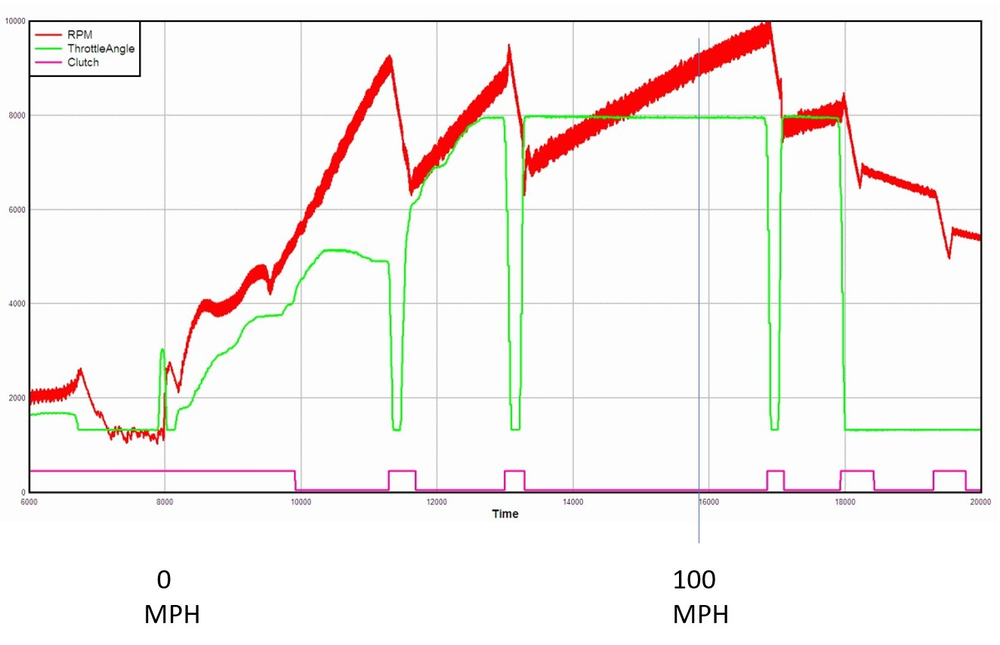
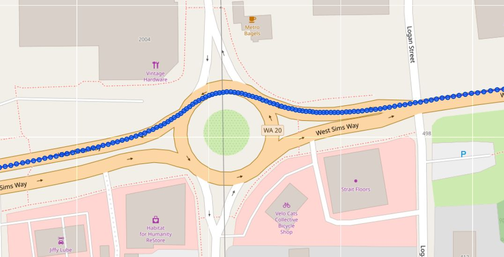
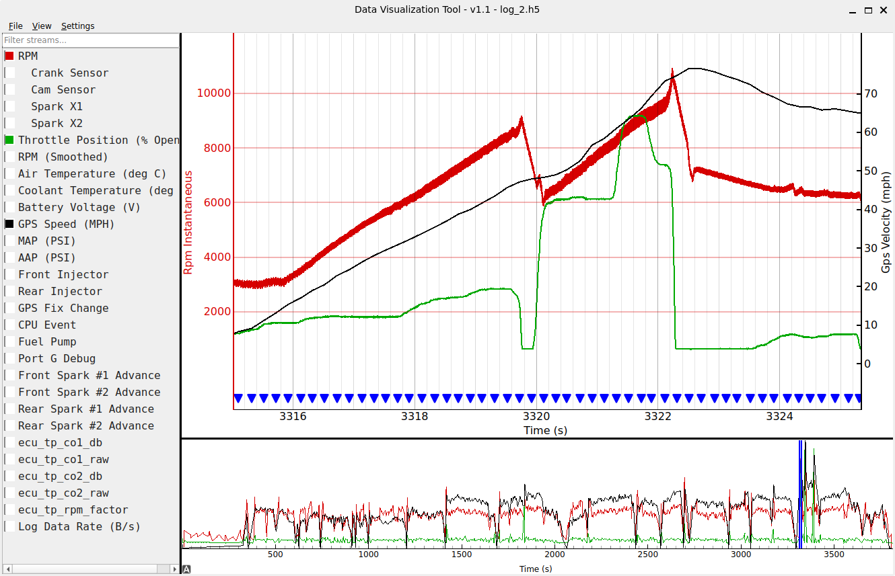
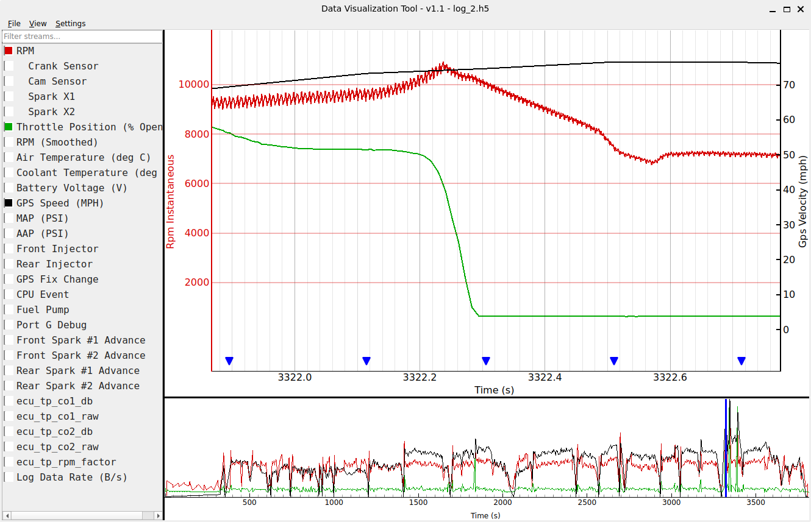
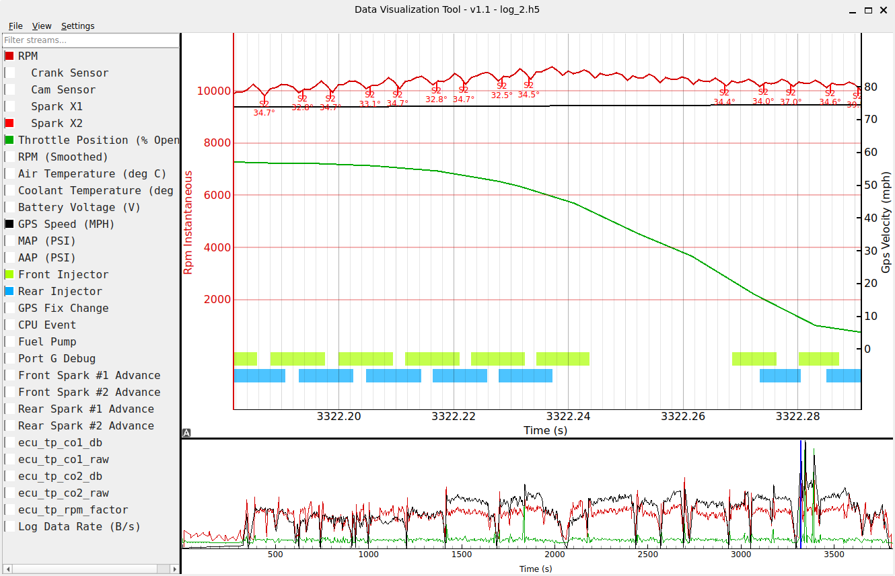
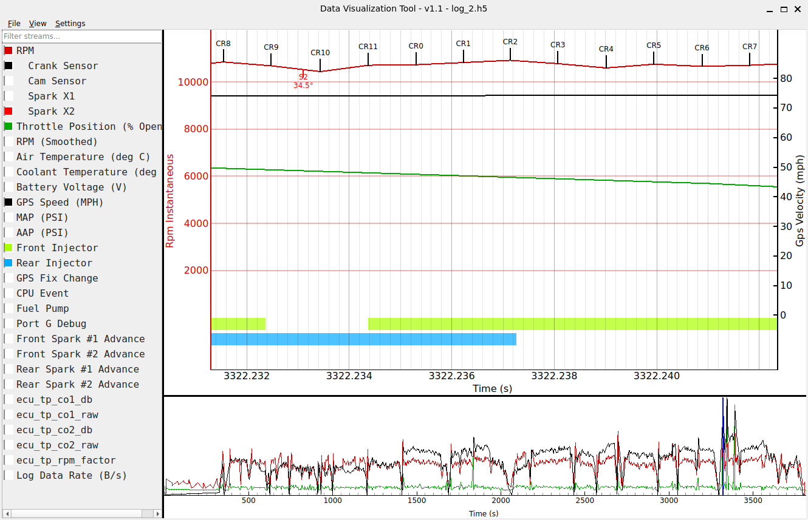
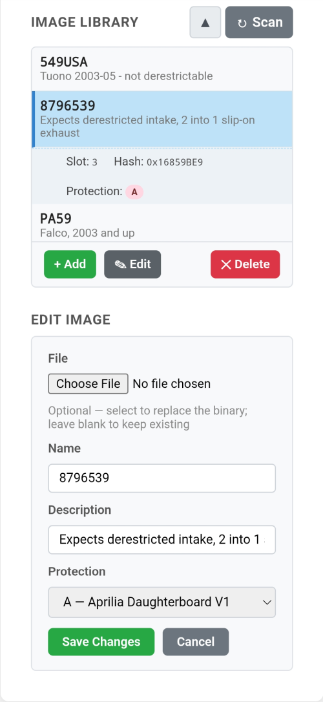
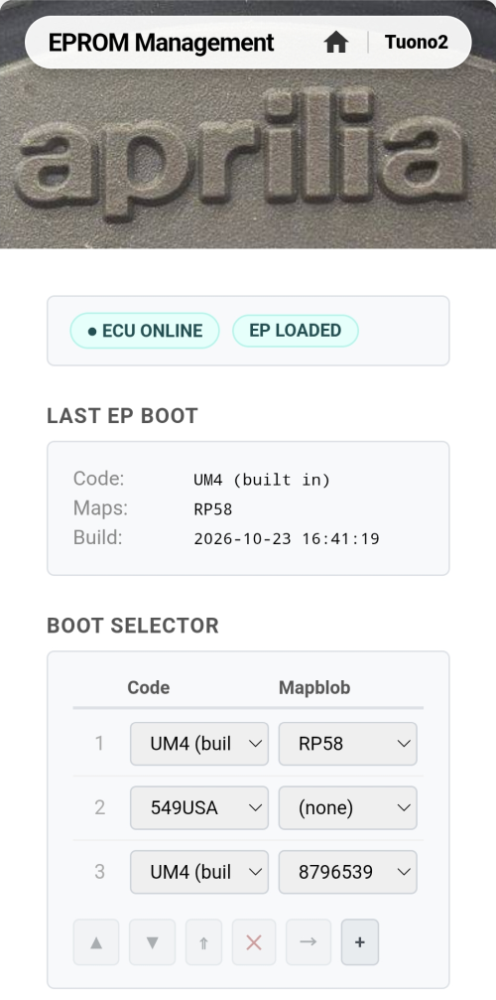

# Why a Umod4?

**Your bike's fuel injection computer already knows everything about how you ride.
A umod4 datalogger lets you see it.**

The umod4 is a circuit board that replaces the program chip inside an early Aprilia ECU.
The bike runs exactly as before, but now it records every ride.
A built-in WiFi interface allows you to control and monitor umod4 operation with your phone, at home or at the track.

*This log is from back around 2007, displayed using a really old version of the log visualizer.
It shows throttle, RPM and clutch operation from a real 0–100 MPH run.
You can see the clutch slipping in first gear then locking up, lazy shifts into second and third, passing through 100 MPH before shutting things down.*

## What it does for you

### See where you went

The umod4 records your 3D location and velocity 10 times per second during your rides.

Each blue dot can be correlated back to the ECU data stream to see what the rider was doing, and how the engine was responding at that moment in time.

### See what you actually did

Every ride is completely recorded: throttle position, RPM, engine sensor data, spark and injector timing, all correlated to GPS position and velocity, visible on one timeline.
Was that corner as fast as you thought?
Where did you really shift?
The umod4 knows!

The log is very detailed: if you zoom in far enough, you can see each individual turn of the crankshaft, even at redline.

Here is a test ride showing the level of log detail that is available:

The green line (throttle position) shows that I fed in a fairly small amount of throttle in 1st gear but just let the revs slowly climb over the next 4 seconds.
At 9000 RPM, I shifted to 2nd gear and fed in more throttle.
As the tach crossed 10,000 RPM, I pulled the clutch in and closed the throttle.
That little spike in RPMs as the engine crossed 10,000 RPM shows that my throttle was not quite closed when the clutch disengaged.
You can clearly see the revs momentarily pop up over 10K RPM.
Zooming in on that event shows this:

You can see that it took me under 100 milliseconds to close the throttle (green line).
The issue was that with the clutch disengaging, the throttle was still open enough to allow the engine to pick up revs anyway.

And if we zoom way in to see 20-ish crank rotations right around that peak RPM, we see something very interesting:

Enabling the data streams for coil #2 spark events and the injector timing makes things very clear.
The ECU detected an over-rev condition.
The first thing it did was to disable the sparks.
The second thing it did was to disable the injectors.
Once the revs dropped below the redline again, the sparks and injectors started working again.

Just to prove a point, here is a view of 2 rotations of the crank just as the engine went into overrev.
Each CRn event represents 60 degrees of crankshaft rotation.
The width of the screen covers 10 milliseconds.
The S2 "Spark Event" marker shows when the ECU detected that coil #2 had fired.
Since the S2 event was detected during CR9, we know that it was the rear cylinder's coil #2.
Spark events are tagged on the display with their measured spark advance, 34.5 degrees BTDC in this case.

### Get more information about problems

"It stumbles around 4000 RPM when it's cold" is hard to chase.
With a log, you can go back to the exact moment it happened and see what the sensors and the engine were doing.

### Change the ECU's program without a chip burner

The umod4 holds a library of ECU programs in its own memory.
Add one through a web page, give it a name and some notes, and pick which one the bike will use next time you turn the key.
No pulling the ECU from under the seat, no swapping EPROMs!

The image library, showing EPROM names and notes:

The `Boot Selector` control allows a rider to choose what image to run when the ignition key turns on next.
It takes the form of a list so that in the extremely unlikely event that an image failed to load (checksum error, etc), the umod4 would just try loading the next image in the list.
If no images can be loaded from the list, the umod4 will run a built-in 'limp mode' image to get you home again.

The entries in the Boot Selector list let you combine the data logging code (the `UM4` code in the screenshot above) with the entire map set from any other RP58-compatible EPROM (called the 'mapblob').
In short, it means that the datalogger will work with your own custom chips or map set.
Tuning programs like TunerPro produce '.bin' files that the umod4 can use directly.
If you only have access to a physical EPROM chip, you will need to get a copy of your EPROM data as a '.bin' file.
Any EPROM reader can do this.
For extra fun, you can even [make your own EPROM reader](https://github.com/mookiedog/burner).

### Tuning: try a change, then see what it did

Tuning an engine is a loop: change something, ride, find out whether it helped, repeat.
The slow, awkward parts of that loop are swapping the ECU's program and then knowing what happened.
The umod4 speeds up both.

* **Swapping is quick.**
  Before a ride, you can load up several test versions of your maps in the umod4's library, each with a name and notes.
  Swapping images is done from your phone: no pulling the ECU, no removing chips, no erasing, no burning.
  Changes take seconds!
* **Tuning Experiments are logged permanently.**
  When the ECU powers up, one of the first things it does is to send the entire mapblob contents to get logged into the permanent log file.
  This means that you can dig out an old log file from months ago and know precisely what mapset it was using.
  Map information cannot be lost!
* **Mistakes are cheap.**
  If an experiment goes badly, you can easily restore the ECU to a working image, even away from home.

**What the umod4 does not do (yet):** it is not a map editor.
Creating a modified map still needs another tool like TunerPro.

*Note 1: nothing would stop someone from adding a tuning tool to this project.
Case in point: the entire visualizer program was written by Claude Code.
It would not be a stretch to vibe code a tuning tool.*

*Note 2: Making changes to the ECU software or ECU Tuning tables is potentially dangerous and/or deadly!
If you want to do things like that, the umod4 project permits it, but you are 100% on your own: No warranty, no guarantees!*

### Logs and updates arrive by WiFi

If your garage has WiFi, ride logs get downloaded from the bike every time you come home.
Software updates can be pushed to the bike via WiFi too.
No cables, no SD card readers required.

## What it's like to live with

Since the umod4 loads your favorite EPROM image every time you turn the ignition on, the entire process is: key on, go riding.

After a ride, the only things you need to do are park the bike within range of your home WiFi signal, then plug the umod4 into a USB charger to activate its WiFi interface.

The umod4 will tell the server that it is home, and the server will automatically pull off all the new ride logs.

That is the whole routine.
If nothing else, it's a good excuse to finally get WiFi out to your garage.

## Is it for you?

There are some things to consider before diving in:

* **It only works on Gen 1 Aprilia ECUs for 1000cc Rotax twins.**
  The project was built and tested on a Gen 1 Tuono, but it should work on any Falco or big-valve Mille that came with a Gen 1 ECU.
* **Installing it means some electronics rework.**
  A connector has to be soldered into the ECU's circuit board, and the ECU has to be opened.
  This is not a difficult operation for anyone with soldering skills.
  The new connector does not affect the ECU operation in any way.
  At any point, the umod4 board can be removed, and an EPROM can be socketed in its place.
* **You need to supply your own EPROM .bin file.**
  The project does not include any stock or aftermarket EPROM images.
  You have to source them yourself.
  Stock images can be found on the web as .bin files: Google is your friend.
  If you are running an aftermarket chip, you will need to use an EPROM reader to extract its .bin file.
* **Protected EPROMs are not directly supported.**
  The umod4 software will work with protected EPROMs if you supply source code for an appropriate decoder.
  Decoders for protected EPROMs are not included, and are **not accepted into this repository**.
  If you write your own, the umod4 software will use it.
* **It is a hobby project, not a product.**
  Most important: There is no company behind this, no support desk and no warranty.
  The whole thing is open and free, and it exists because it represents literally 20+ years of fun for me.
  If you like figuring things out, that is a feature.
  If you want something that just works with someone to call, this is not it.

## Getting a board

Replicating the umod4 software and build environment is a solvable software problem.
The hard part is getting an assembled board.

To make the construction process easier, the board is designed to be fabricated at JLCPCB.
This means that JLCPCB fabricates the circuit board, then assembles most of the parts onto it.
Getting the factory to assemble the boards is necessary because some of the parts on the board are very fine pitch, and extremely hard to solder by hand.
The assembly process is surprisingly cheap.

The [PCB repository](https://github.com/mookiedog/umod4-PCB) contains all the design files that JLCPCB requires to have the PCB fabricated, and then to be assembled afterwards.

What is missing is a step-by-step guide to make that happen so that anyone could order a batch of boards (minimum order is 5).

For the moment: the only way to get a board is to have some fabricated for yourself.
If you have ordered assembled boards from JLCPCB before, everything you need can be found in the PCB repo.

## Where to go next

There is plenty more to read, if you are still interested.
Start here:

* **Ready to try it?** Start with the [Getting Started guide](GETTING_STARTED.md).
* **Want to see more of the logs?** The [visualizer page](tools/README_Visualizer.md) has much more.
* **Curious how it works inside?** The [project README](README.md) has the history and the hardware.
