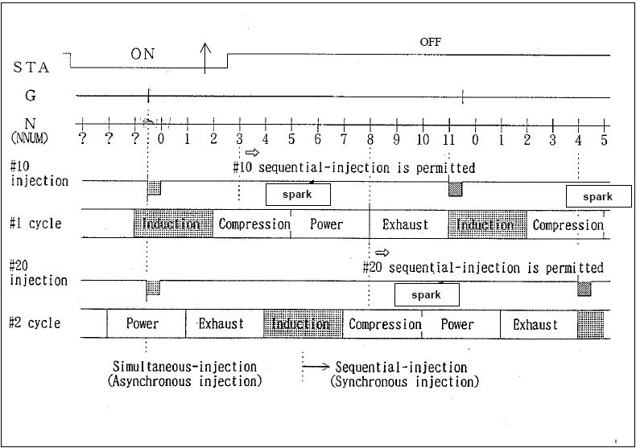

# ECU Operation

## General Operation

The following diagram shows the operational sequencing of the engine as it starts and moves through its first rotation and a half:

The '#1 cycle' in the diagram refers to the front cylinder operation, and '#2 cycle' refers to the rear.

### Injectors

On the diagram, the '#10 injection' refers to the front cylinder injector #1, and '#20 injection' refers to the rear cylinder injector.
If you look at the ECU PCB silkscreen, these are actually numbered #11 and #21, respectively.
In addition, the ECU circuit board is designed to drive *two* injectors per cylinder.
The secondary injectors are labeled #12 and #22 on the PCB.
The pairs of injectors are wired together on the PCB so they would always fire simultaneously.
The ECU software would never be able to control the injector pair independently.
It doesn't really matter though because:

* the Aprilia circuit board does not contain the parts needed to drive the secondary injectors #12/#22, and
* the throttle body itself only implements one injector for the front cylinder and another for the rear

### Crank Reference (CRn) ID Numbers

The number 'N (NNUM)' in the diagram is what the umod4 firmware refers to as 'CRn', or 'Crank Reference N', where N ranges from 0 to 11.
There are 12 CR periods because:

* the Aprilia engine tracks each rotation of the crank as 6 equal parts of 60 degrees (360 degrees being exactly 1 rotation)
* a 4-stroke engine requires 2 full rotations to perform a complete 4-stroke cycle

The diagram makes it clear how each 60 degree portion of a crank rotation maps onto the 4-stroke operation for each cylinder.

Because of the way that the crankshaft is designed and because the cylinders are splayed 60 degrees apart, the power strokes of the two cylinders are unequally spaced around the 2 rotations of a 4-stroke cycle.
On the diagram, the front cylinder's power stroke begins at about CR5.
The rear cylinder's begins five 60-degree CR periods later, at about CR10.
The front cylinder's next power stroke begins seven periods after that, back at CR5.
This is one of the fundamental reasons that V-twin engines vibrate: uneven firing pulses.

### The CR periods do not line up exactly with the strokes

The diagram draws every stroke as a whole number of CR periods, which makes it easy to read.
The real engine differs from the diagram, as the following shows:

* A CR event starts as the leading edge of a rotor protrusion passes under the crank sensor.
  It is a position marker, and it is not required to align precisely with the start of any part of a stroke
* **Documented Facts**
  * The leading edges of the rotor protrusions are known to be exactly 60 degrees apart
  * The Rotax V990 shop manual (p. 2-6) says that the ignition advance while starting is 5 degrees BTDC
  * The ECU source code indicates that the ECU will fire the coil on the trailing edge of CR5 (front) or CR10 (rear) when starting
* **Measurements** Each protrusion measures out at 7 degrees wide (9.15 mm protrusion width on a 150.7 mm diameter rotor means the protrusion must be 6.96 degrees wide)

Putting it together:

* If the trailing edge of CR5 is at 5 degrees BTDC, then the leading edge (the CR5 event) must be at 12 degrees BTDC
* CR4 must be 60 degrees earlier, at 72 degrees BTDC.
  See [Ignition.md](Ignition.md) and the comments in UM4.S

*Caveat: Nobody has measured the position of the rotor protrusions relative to TDC or BDC on a real engine, so treat them as the best available estimate.*

For the front cylinder, the CR periods fall against the crankshaft like this:

| Period | Crank angle (degrees from front TDC) |
| --- | --- |
| CR4 | 72 to 12 before TDC |
| CR5 | 12 before to 48 after |
| CR6 | 48 to 108 after |
| CR7 | 108 to 168 after |
| CR8 | 168 to 228 after |

The rear cylinder is the same, shifted by five periods: its TDC falls 12 degrees into CR10.

That puts the front power stroke (0 to 180 degrees after TDC) across the last 48 degrees of CR5, all of CR6 and CR7, and the first 12 degrees of CR8.
In the same way, the compression stroke covers the last 48 degrees of CR2, all of CR3 and CR4, and the first 12 degrees of CR5.
Combustion starts before TDC, because the spark is fired ahead of it: 5 degrees BTDC while starting, and 21.8 degrees (plus or minus 2) at 2800 RPM, according to the shop manual.

Even with perfect knowledge of the angles, the instantaneous RPM as the crank goes through a single rotation would still look a bit fuzzy.
A closed throttle does not mean no forces: the compression stroke still slows the engine a bit, and there is still a small power stroke.

### Power Strokes

Even though the periods are fuzzy, we can say where the crank should speed up during a power stroke.
The power stroke does not push on the crank equally through its three 60-degree portions.

* **Near TDC:** the cylinder pressure rises rapidly, but the connecting rod is almost vertical.
  The piston can push as hard as it likes, but the rod has almost no mechanical advantage over the crankshaft
* **Mid-stroke:** the rod angle has opened up, and the pressure is still high.
  This is where combustion pressure is converted into crankshaft rotation most efficiently
* **Late stroke:** the cylinder volume has grown a lot, so the pressure has dropped, and the rod is approaching vertical again.
  What is left of the cylinder pressure is fighting rapidly decreasing mechanical advantage

So for the front cylinder we expect little speed gain in CR5, the most in CR6, and a little in CR7.
The other cylinder complicates this: while the front cylinder is in CR7, the rear is starting its compression stroke, which drags on the crank and can hide some of the front's late power.

### Observations

Logs of full-throttle acceleration broadly agree with these expectations.
The time taken by each CR period shows the crank speeding up through CR5 and CR6, with the larger gain in CR6, and with essentially no gain through CR7.
The effect is small, a few percent of the average speed, and the CR periods are fuzzy as described above, so it is a trend, not a precise measurement.
